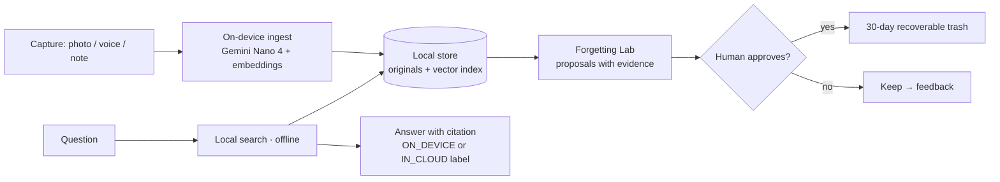

# My Memory

**A second memory in your pocket.** Capture a photo, a voice memo, or a note, then ask for it later
in plain words — the answer comes back with the original capture as evidence, runs locally, and
deletes memories only through human approval or explicit user-triggered trash/delete controls.

## About

My Memory (also called *Pocket Knowledge*) is a privacy-first personal knowledge app for the
**Android (primary) + Web/Chrome (companion)** track.

It solves a familiar failure: you capture a receipt, a licence plate, or a medicine box, and then
cannot find it again. Phone galleries search by name and date; note apps demand folders and tags at
the exact moment you have no patience for them; cloud photo search sends private material off the
device. My Memory adds the missing layer — **a memory with an evidence rule**: one local store for
every capture type, retrieval that returns the original as proof, and a forgetting policy where the
machine proposes and the human decides.

The design is built on four principles:

- **On-device by default.** Transcription, embedding, and search stay on the phone; the cloud is a
  last resort for long, cross-capture synthesis only.
- **Evidence or refusal.** No answer without a cited capture — "not found" is a valid result.
- **Human-in-the-loop forgetting.** The app proposes what to forget; nothing is deleted without
  approval, and approved items sit in a recoverable trash for 30 days.
- **Offline is the default, not a degraded mode.** Capture, indexing, and short answers work with
  the network unplugged.

## Features

- **Capture anything, organise nothing** — a photo, voice memo, or note, with no filename, folder,
  or tag requested at capture time.
- **Ask in plain words** — e.g. "when does mum's medicine expire?" returns the expiry with the
  original photo, date, and match score attached.
- **Cited answers** — every factual claim links to the source capture; uncited claims are suppressed
  rather than softened.
- **Hybrid inference** — extraction of originals runs with `ONLY_ON_DEVICE` so a photo or transcript
  is never sent to the cloud; short answers use `PREFER_ON_DEVICE` and long cross-capture synthesis
  uses `ONLY_IN_CLOUD`. The response's `inferenceSource` drives an on-device vs cloud-synthesised
  label in the UI, so a fallback is never mistaken for a local result.
- **Offline-first local search** — a local vector index keeps photos, transcriptions, and notes in
  one searchable space, working in airplane mode.
- **Forgetting Lab** — duplicate and expiry proposals carry a reason and a link to the original.
  Unique health or safety captures are protected, and a "keep" decision teaches the curator.

## How it works

| Step | What happens |
| :--- | :--- |
| **Save** | Firebase AI Logic calls Gemini Nano 4 in `ONLY_ON_DEVICE` mode to return structured JSON (`summary`, `entities`, `expiryDate`). The original blob is stored read-only next to its embedding and is never replaced by the summary. |
| **Ask** | Local search finds candidate captures offline. Nano 4 resolves intent and produces a short, cited answer; only long cross-capture synthesis escalates to the cloud, sending light JSON summaries rather than originals. |
| **Forget** | Cosine similarity over embeddings plus extracted expiry dates feed a proposal queue. The user approves or keeps each item; approved captures move to a 30-day recoverable trash. Remote Config may tune the scoring threshold, never the forgetting rule. |



## Tech stack

The models are pinned by the build specification: **Gemini Nano 4 only** for on-device inference
(no Nano 3 / Nano 2 downgrade) and **EmbeddingGemma 2 only** as the embedder.

| Layer | Choice |
| :--- | :--- |
| Hybrid inference | Firebase AI Logic Hybrid Inference SDK, `PREFER_ON_DEVICE` |
| On-device model | Gemini Nano 4 (Chrome Prompt API on Web / on-device runtime on Android) |
| Cloud escalation | `gemini-3.8-flash`, with `gemini-3.5-flash-lite` as the default fallback |
| Embeddings | EmbeddingGemma 2, on-device |
| Transcription / OCR | On-device ASR and OCR |
| Platforms | Android (Kotlin) primary; Web (Chrome) + IndexedDB companion |
| Firebase services | App Check, Cloud Firestore (offline persistence), Remote Config |
| Output | Schema-constrained structured JSON |
| Web scaffold | Vite + React + TypeScript + Tailwind CSS |

## Repository layout

- [`docs/README.md`](docs/README.md) — documentation map and reading order.
- [`docs/ARCHITECTURE.md`](docs/ARCHITECTURE.md) — system index into the as-built zone.
- [`docs/requirements/`](docs/requirements/) — business brief and numbered requirements.
- [`docs/as-built/`](docs/as-built/) — current data, UI and verification truth.
- [`docs/operations/WEB_SETUP.md`](docs/operations/WEB_SETUP.md) — local and Firebase setup.
- [`docs/plan/tasks.md`](docs/plan/tasks.md) — single source of truth for tasks.
- [`docs/rfc/`](docs/rfc/) and [`docs/adr/`](docs/adr/) — historical design and decisions.
- [`docs/prototypes/`](docs/prototypes/) — design prototypes.
- `LICENSE` — Apache License 2.0.

## Project status

The Web/Chrome companion is implemented in `src/`. Google sign-in vs explicit Demo mode,
camera + multi-select gallery photo EXIF import, user tags + auto-tag suggestions, automatic F4
protection, manual deletion + 30-day Trash (`permanent delete` option), 3-counter HUD, and
fail-closed verification are in place; physical Android/Chrome 139+ hardware checks and live
Firebase Console setup remain open — see `docs/plan/tasks.md`.

| Surface | Status |
| :--- | :--- |
| Public repository | `Dylanzsnut/my-memory` |
| Android (Kotlin) capture and on-device query | Not started |
| Web/Chrome companion (React + IndexedDB) | Implemented |
| Hybrid inference, citation evidence, human/manual forgetting & Trash | Implemented with labelled local fallbacks |
| Google sign-in / Demo mode + per-user Firestore rules | Implemented in code (Console provider config external) |
| Hosted build | `https://my-memory-hybrid-2026.web.app` |
| Demo video | None |

## Getting started

The Web app is runnable locally. Copy `.env.example` to `.env`, fill in Firebase
values for live inference and Google sign-in, then:

```bash
npm install
npm run dev        # start the Vite dev server
npm run typecheck  # TypeScript check
npm run build      # type-check and build
```

Start with [`docs/README.md`](docs/README.md). Historical design and original
build targets are in [`docs/rfc/`](docs/rfc/); they do not override as-built docs.

## Roadmap

- [ ] Push the Android capture and on-device query implementation.
- [x] Build the Web/Chrome companion (Prompt API + IndexedDB).
- [x] Wire hybrid inference, citation evidence, manual/AI deletion approval, and auth modes.
- [ ] Publish an updated hosted build and an English demo video (under 3 minutes).

## License

Apache License 2.0 — see [`LICENSE`](LICENSE).
