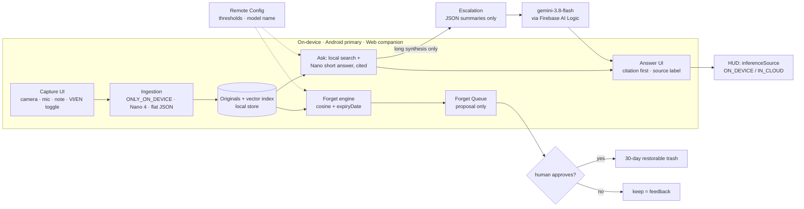

# CSD v1.1 — My Memory: Pocket Knowledge Like Human Memory

**Project:** My Memory — capture anything, find it instantly, and learn to forget with your approval.
**Contest:** [#BuildHybridAI 2026](../../competitions/firebase-hybrid-ai-hackathon.md) (Firebase AI Logic, Devpost).
**Track:** Android (primary) + Web/Chrome companion — one multi-platform submission.
**Deadline:** submissions close **2026-11-30, 2:00 PM PT** (= 2026-11-30 17:00 ET = 2026-12-01 05:00 ICT). Judging runs **2026-12-10 → 2026-12-16**; winners announced on or around **2026-12-21**. All times Pacific Time per the brief.
**Status:** DRAFT v1.3, 2026-11-17 — for implementation. Supersedes v1.2 / v1.1 / v1.0 of this document and the earlier smart-home CSD as the active BuildHybridAI entry draft.
**Language:** English (submission materials must be in English). The app defaults to English with a VI / EN toggle.
**Companion artifacts (in this project folder):**
- `idea.md` — conceptual solution design (8 sections).
- `my_memory_design_1.html` — interactive design prototype (EN/VI, sample data only).
- `my_memory_ux_architecture_interaction_loops_specification.md` — UX architecture and interaction loops (v2.1).

> **Everything numeric here is a design target, not a measured result.** Latency figures, similarity
> scores and match values are mockup/spec values until the §12 test set is run. Where a number is
> measured later, this document says so.

**Sources for the technical facts below:** the competition brief
[#BuildHybridAI 2026](../../competitions/firebase-hybrid-ai-hackathon.md) (tracks, checklist,
rubric, dates) · [Firebase AI Logic hybrid inference docs](https://firebase.google.com/docs/ai-logic/hybrid)
(inference modes, `inferenceSource`, structured output, model selection — Android and Web) ·
[EmbeddingGemma 2 announcement, 2026-10-06](https://blog.google/innovation-and-ai/technology/developers-tools/embeddinggemma-2/)
and its [model card](https://ai.google.dev/gemma/docs/embeddinggemma/model_card_2) (embedding model
facts). API and model facts taken from those pages are marked in Appendix C.

---

## 0. What this document is

This CSD turns the My Memory concept agreed on 2026-11-17 into a buildable specification. The
concept in one line: a pocket knowledge system that works like human memory — you capture things as
they happen, you find them the moment you need them, and the system itself proposes what is no
longer worth keeping.

**What v1.1 changes against v1.0 (accuracy and detail pass):**

1. **Compliance sections are now sourced from the competition brief itself** (§13, §14): the exact
   Stage One / Stage Two rubric, prize structure, submission checklist, and the dates in PT.
2. **Model naming is unified.** v1.0 said "Gemini Flash / Pro"; the concept design and the brief
   require named models. This version pins `gemini-3.8-flash` (cloud synthesis) with
   `gemini-3.5-flash-lite` as fallback, and treats model ids as a build-time verification item
   because model names move fast (see §18.1).
3. **The data model is merged.** v1.0 carried only the flat on-device extraction JSON. §5 now also
   carries the stored capture record fields from `idea.md` §4.2 (`original_ref`, `derived_text`,
   `embedding`, `source_match`, `retention_state`), with an explicit "never leaves the device"
   column.
4. **Tool contracts are included** (§10) with their guardrails, taken from `idea.md` §6.
5. **UI/UX is mapped explicitly** (§11) to the UX spec: three tabs plus a contextual detail sheet,
   four interaction loops, the design system tokens, and the judge-facing counters.
6. **Graceful degradation is a first-class flow** (Flow 7), because the Android track mandates
   "graceful behavior on devices without a local model".
7. **Cross-language retrieval is treated as a v1 requirement** (§8), not a stretch goal.
8. **Sample-data disclosure** is added (§14): the prototype's receipt, medicine-box and password
   strings are synthetic UI illustration, not real captures.

**What v1.2 adds (source-verified API and model facts):** the four documented inference modes with
their exact fallback/throw semantics and a per-call-site mode table (§4.4); the structured-output
API shape (`generateObject()` + `@Generable`, §4.1); the on-device model *category* system
(`STABLE` / `PREVIEW` / `PREVIEW_FAST`) that decides whether "Gemini Nano 4" is selected at all
(§4.1); the documented cloud-fallback model default and where model names must be set (§4.2); and
the EmbeddingGemma 2 embedding layer with its multimodal unified space, MRL dimensions and
footprint (§5.1). See Appendix C.

**What v1.3 pins:** two model choices become hard requirements rather than preferences. On-device
inference is **Gemini Nano 4 only** — the `PREVIEW` / `PREVIEW_FAST` categories, with no `STABLE`
downgrade to Nano 3 / Nano 2. The embedder is **EmbeddingGemma 2 only**, with no predecessor
fallback. A device that cannot run either one degrades visibly per Flow 7 instead of substituting
a different model.

**Two corrections carried forward from v1.0 and kept here rather than repeated from the pasted
mapping:** voice memos do not go through Gemini Nano via Firebase AI Logic (audio is not a Nano
input), and on Android Nano runs through AICore on the phone, not in a browser. Both are built into
the architecture in §4 and logged in Appendix A.

---

## 1. Problem and audience

**Audience:** one person, one phone, and the stream of small facts that person cannot afford to
lose. First user: the builder, dogfooding with real captures — receipts, medicine boxes, license
plates, Wi-Fi passwords, menus, and voice notes taken in the moment.

**Problem:** people already capture these facts. They photograph a receipt, record a voice memo,
type a quick note. The capture is easy; the retrieval is what fails. Weeks later the question is
never "did I write this down" but "where did I see this" — which photo holds the medicine name,
which note holds the plate number, which memo holds the price. Each capture type lives in a
different app with a different search, none of them search across the others, and none of them work
offline as one memory. The second failure is accumulation: because nothing is ever cleaned up, the
pile grows until even a good search returns clutter, duplicates, and expired facts alongside the
one capture that matters.

**The 5-second pitch:** "Capture anything. Find it instantly."

In Vietnamese, for the home audience: "Chụp gì cũng nhớ, hỏi gì cũng ra."

**Named failure modes** (from `idea.md` §1.4 — each is a design constraint, not a caveat):

| # | Failure mode | What it looks like | Where this design blocks it |
|---|---|---|---|
| 1 | Fabrication | An answer states an expiry or amount that is in no capture | G1/G2 + `citation_verifier` (§7.1, §10) |
| 2 | Evidence loss | A derived summary replaces the original, so the claim cannot be checked | Original blob is read-only and stored beside the index (§5) |
| 3 | Silent auto-deletion | A cleanup routine removes the only copy of a health capture | F4 protections + F5 proposal-only path (§7.2) |
| 4 | Network dependence | An offline user gets no answer, or gets an answer assembled elsewhere | Local index + on-device retrieval first (§4.2, Flow 3) |
| 5 | False forgetting proposals | A blurry but unique photo is flagged as redundant and nudged toward trash | F4 + evidence-linked reasons + "keep" as feedback (§7.2) |

**Why this is not Google Photos, Recall, or NotebookLM.** Each of those covers one slice well.
Photos searches photos. NotebookLM synthesises documents you deliberately assemble. Recall records
a screen history. My Memory is one local index over three capture types — photo, voice memo, and
text note — where a text question can return a photo as its answer, every answer carries the
original capture as evidence, and the system proposes forgetting as a first-class feature. The
differentiator is the combination, not any single feature: one index, grounded answers, and
human-approved forgetting.

---

## 2. Concept — three screens, one memory

The whole product is three screens. If a feature does not belong to one of them, it is not in v1.

1. **Capture — save it all.** The user photographs, records, or types. Ingestion runs on-device and
   turns the raw capture into a small structured record (§5) plus an embedding. The user does
   nothing else: no folder, no tag, no title is required at capture time.
2. **Ask — find it with evidence.** The user asks in plain language, in English or Vietnamese. Local
   search returns in under one second, offline. Every answer is shown with the original capture it
   came from — the photo, the audio, the note — opened at the exact item. No evidence, no answer
   (§7).
3. **Forget — learn to let go.** The system watches for captures that look duplicate or expired and
   places them in a Forget Queue with a stated reason and the evidence for that reason. The user
   approves or keeps each one. The system never deletes on its own (§7).

**Human memory is the model, with one deliberate difference.** Human memory forgets, and forgetting
the right things is part of what makes it useful. Human memory also confabulates — it fills gaps
with plausible detail. My Memory copies the forgetting and refuses the confabulation: every number,
name, and date in an answer must come from a capture the user can open and check.

**Screen-to-UI mapping** (authority: the UX spec, §2 and §3):

| Concept screen | UI surface | Interaction loop (UX spec §3) |
|---|---|---|
| Capture | Tab 1 **Memories** (feed + 1-tap Snap / Record / Note toolbar) | Loop 1 — zero-effort capture |
| Ask | Tab 2 **Ask** (conversational bar, suggested chips, answer + evidence card) | Loop 2 — inquiry and proof |
| (inspect) | **Memory Detail & Evidence** contextual sheet (not a root tab) | Loop 3 — drill-down from feed |
| Forget | Tab 3 **Forget** (guided review queue, reasons, Move to Trash / Keep) | Loop 4 — mindful forgetting |

---

## 3. Trust boundary

The standing rule for all of the user's neuro-symbolic work applies here unchanged: **the model
proposes, deterministic logic and the human dispose.**

- The model proposes summaries, entities, search rankings, synthesised answers, and forget
  candidates. It decides none of them.
- Deterministic rules decide whether an answer may be shown (it must carry a citation), whether a
  capture may enter the Forget Queue (it must match a forget rule with measurable evidence), and
  what may never be proposed for deletion at all.
- The human decides deletion. A forget proposal is a proposal until the user approves it. There is
  no auto-delete path in the codebase, not behind a setting and not after a timeout.
- The system is fail-closed. If retrieval finds nothing above threshold, it says it found nothing.
  If ingestion cannot extract a field, the field stays empty rather than being guessed. If the
  on-device model is unavailable, the app says so instead of silently uploading the capture to the
  cloud.
- **Mode choice enforces that boundary.** `PREFER_ON_DEVICE` falls back to the cloud automatically,
  so any call whose payload would contain an original runs in `ONLY_ON_DEVICE`, which throws
  instead of falling back. The app then degrades to an unextracted capture. See §4.4 and ADR-09.

**What leaves the device (exhaustive list; nothing else leaves):**

| What | Leaves the device? | Where it goes | When |
|---|---|---|---|
| Original photo / audio / note text | **No** | — | — |
| On-device ASR transcript of a voice memo | **No** | — | — |
| Embedding vector | **No** (metadata sync optional; see D4) | — | — |
| Structured JSON: `summary`, `entities`, `expiryDate`, timestamps | **Yes, metadata only** | Firestore, offline persistence | Metadata sync between phone and computer |
| Structured JSON summaries of selected captures | **Yes, light payload only** | Cloud model via Firebase AI Logic | Only for multi-capture / long synthesis (Flow 5) |
| Inference request/response envelope | **Yes** | Firebase AI Logic (App Check enforced) | Every AI call |

The privacy boundary is data, not just latency. The cloud answer must return claims the device can
re-attach to local captures; it is never given the originals it would need to replace them.

---

## 4. Architecture — Firebase AI Logic hybrid

```text
+--------------------------------------------------------------------------------+
| PHONE (Android — Xiaomi 17T Pro, Gemini Nano 4 via AICore; verify at runtime)  |
|                                                                                |
|  [Photo] [Voice memo] [Text note]                                              |
|      |         |            |                                                  |
|      v         v            v                                                  |
|  +---------------------------------------------------------------------------+ |
|  | Ingestion (on-device)                                                     | |
|  |  Photo / note text -> Firebase AI Logic, ONLY_ON_DEVICE, Gemini Nano 4:   | |
|  |    flat JSON {summary, entities, expiryDate} (see §5)                     | |
|  |  Voice memo -> on-device ASR -> transcript -> same Nano path for JSON;    | |
|  |    EmbeddingGemma 2 embeds photo / audio / text directly                   | |
|  |  EmbeddingGemma 2 -> one shared embedding space for all three types       | |
|  +----------------------------------+----------------------------------------+ |
|                                     | capture record + embedding               |
|                                     v                                          |
|  +---------------------------------------------------------------------------+ |
|  | Local store (on-device)                                                   | |
|  |  Originals: photos, audio, notes — never leave the device                 | |
|  |  Index: embeddings + capture records, local vector search < 1 s, offline  | |
|  +----------------------------------+----------------------------------------+ |
|                                     |                                          |
|        +----------------------------+----------------------------+             |
|        v                                                         v             |
|  +------------------+                              +-------------------------+ |
|  | Ask (local)      |                              | Forget engine (local)   | |
|  |  Vector search + |                              |  Cosine similarity +    | |
|  |  Nano short      |                              |  expiryDate rules ->    | |
|  |  answer, cited   |                              |  Forget Queue (propose  | |
|  |                  |                              |  only, §7)              | |
|  +--------+---------+                              +------------+------------+ |
|           | complex question only                               | user         |
|           | (light JSON summaries,                              | approves     |
|           |  never originals)                                   v              |
+-----------|-------------------------------------------------- trash (30 days)-+
            v
+--------------------------------------------------------------------------------+
| CLOUD (only when local cannot do it)                                           |
|  Firebase AI Logic cloud model (gemini-3.8-flash; fallback gemini-3.5-flash-   |
|    lite): deep synthesis across many captures from their JSON summaries only   |
|  Firestore (offline persistence on): syncs metadata / capture records only,    |
|    never original photos or audio                                              |
|  Remote Config: forget thresholds (e.g. duplicate similarity 0.95 vs 0.97),    |
|    retrieval threshold, escalation threshold, model name override              |
|  App Check: required, enforced (debug tokens accepted in submissions)          |
+--------------------------------------------------------------------------------+
```



**Layer separation (deliberate):** Firebase AI Logic is the intelligence layer, the local store is
the memory layer, and the deterministic rules are the authority layer. The model never writes to
the store without a schema-valid record, never answers without a citation, and never deletes
anything.

### 4.1 Screen 1 — Capture: on-device ingestion

When the user captures a photo (a receipt, a medicine box, a license plate) or writes a note, the
app calls Firebase AI Logic with `ONLY_ON_DEVICE` and Gemini Nano 4. Nano reads the image or the
text on the phone — no cost, and no sensitive image leaves the device — and returns structured
JSON: a one-line `summary` ("Lunch receipt 256,000 VND"), flat `entities` (medicine name, amount,
plate number), and an `expiryDate` when the capture carries one (medicine expiry 03/2027). That
`expiryDate` is what later feeds the Forget Lab, so it is extracted at capture time, not
reconstructed later.

Voice memos follow a different first step, stated plainly because the earlier mapping got it wrong:
Nano via Firebase AI Logic accepts text and text-plus-image, not audio. A voice memo is transcribed
by on-device speech recognition and the transcript goes through the same Nano extraction path. The
original audio stays on the device as the citable evidence.

**Embedding does not depend on that transcription.** EmbeddingGemma 2 natively embeds audio and
images into the same vector space as text (§5.1), so a photo can be embedded as an image and a memo
as audio. ASR and OCR are needed for exactly two things: the text Nano reads for structured
extraction, and the derived text shown in the UI as *derived*.

**Structured output is a real API contract, not a hope.** Firebase AI Logic generates schema-bound
output through `generateObject()` on both on-device and cloud paths. For on-device and hybrid modes
(`ONLY_ON_DEVICE`, `PREFER_ON_DEVICE`, `PREFER_IN_CLOUD`) the schema must come from a Kotlin data
class annotated `@Generable` / `@Guide` with the KSP processor: the SDK translates it into
constraints for the on-device model (ML Kit Prompt API), and if the request falls back to the cloud
it sets `responseMimeType: application/json` and passes the same schema. Manual `JsonSchema`
construction is cloud-only. This is what makes the flat §5 schema enforceable at generation time:
nullable or defaulted fields become optional properties, which is how `expiryDate` is honestly
`null` rather than guessed. Enum fields must be wrapped in a data class for on-device use.

**Which on-device model actually runs is a category, not a name — and this entry pins the name.**
The SDK selects on-device models by category: `STABLE` (Gemini Nano 3 `nano-v3`, Gemini Nano 2
`nano-v2`, the default when nothing is specified), `PREVIEW` (Gemini Nano 4 Full `nano-v4-full`,
Gemma 4 E4B) and `PREVIEW_FAST` (Gemini Nano 4 Fast `nano-v4-fast`, Gemma 4 E2B). **This entry uses
Gemini Nano 4 only**, i.e. the `PREVIEW` / `PREVIEW_FAST` categories, which require AICore
developer-preview enrolment. `STABLE` is not an acceptable substitute: a device that cannot run
Nano 4 is treated as "no local model" and follows Flow 7, with the degradation visible in the HUD
and stated in the demo. The entry enrols first and verifies that the Xiaomi 17T Pro actually
selects a Nano 4 category (§18.1).

### 4.2 Screen 2 — Ask: hybrid retrieval and cloud escalation

A question is answered locally first. The query is embedded with EmbeddingGemma 2 and matched
against the local index across all three capture types; on a small personal corpus this returns in
under one second, with the network off. Nano then composes a short answer from the top captures,
and the answer is displayed only with its citations attached (§7, rule G1).

Escalation to the cloud happens only when the question needs synthesis across many captures or
across months — for example, "Total my lunch spending this month, and check whether the medicine in
the prescription I photographed yesterday interacts with what Mum already takes." In that case the
app sends the light JSON summaries of the relevant captures to a cloud Gemini model via Firebase AI
Logic. Model selection is explicit and platform-specific: on Android there is **no default
cloud-hosted model**, so `modelName` must be set; on Web the documented default cloud fallback is
`gemini-3.5-flash-lite` (JS SDK v13.0.0+), overridable through `inCloudParams.model`. This entry
pins `gemini-3.8-flash` for synthesis with `gemini-3.5-flash-lite` as the fallback, both
overridable via Remote Config (§18.1). The original photos and audio never leave the phone; only
the summaries the on-device step already extracted are sent. The cloud answer must still cite
capture IDs, and the app resolves those IDs back to the originals on the device before showing
anything.

### 4.3 Screen 3 — Forget Lab: local rules plus hybrid scoring

The Forget engine runs locally. It combines cosine similarity over the embeddings (a near-duplicate
scores around 0.97 against a capture taken 40 seconds earlier) with the `expiryDate` fields
extracted at capture time, and places matches into the Forget Queue. Each queue item carries its
reason and its evidence: the similarity score and the capture it duplicates, or the expiry date and
the date it passed. Thresholds come from Remote Config, so the duplicate threshold (0.95 or 0.97)
can be tuned live without an app update. The engine proposes; only the user's tap deletes, and
deletion means the 30-day trash, not erasure (§7).

### 4.4 Mode decision — when the app chooses local vs cloud

The Web track expects "a clear case for when the app chooses local versus cloud". Firebase AI Logic
exposes four inference modes, and the choice is made per call site:

| Mode | Documented behaviour |
|---|---|
| `PREFER_ON_DEVICE` | Use the on-device model if available and the request type is supported; otherwise **fall back to the cloud-hosted model** (Android logs an error on the device first). |
| `ONLY_ON_DEVICE` | Use the on-device model if available and supported; otherwise **throw**. |
| `PREFER_IN_CLOUD` | Use the cloud-hosted model if the device is online and the model is available; if offline, fall back to on-device; other failures throw. |
| `ONLY_IN_CLOUD` | Use the cloud-hosted model only; otherwise **throw**. |

The SDK reports which path ran through `inferenceSource` (`ON_DEVICE` / `IN_CLOUD`) on every
response in the `PREFER_*` modes (on Web, from JS SDK v12.5.0). The app never guesses the label and
never hides a fallback.

**Per call site in this entry:**

| Call site | Payload | Mode | Why |
|---|---|---|---|
| Ingest (photo / note extraction) | the **original image or text** | `ONLY_ON_DEVICE` | `PREFER_ON_DEVICE` would forward the original to the cloud on fallback. Throwing lets the app keep the original and store the capture as unextracted instead (§5). |
| Voice transcript extraction | transcript text | `ONLY_ON_DEVICE` | The transcript is derived from a private original and must not leave the device. |
| Short cited answer | query + top capture summaries / entities | `PREFER_ON_DEVICE` | Payload is text-only, so a cloud fallback cannot leak an original; the fallback is labelled `IN_CLOUD`. |
| Long synthesis (Flow 5) | JSON summaries of selected captures only | `ONLY_IN_CLOUD` (explicit) | The user asked for a deep synthesis; failure means the app says it needs a connection rather than faking it locally. |
| Availability probe | — | feature / category check | Decides which rows above are reachable; drives Flow 7. |

A question that needs synthesis while offline is answered from local search with an explicit note
that deep synthesis needs a connection. A retrieval below threshold returns "not found" in every
mode. On Web, note that the first on-device request can trigger a model download that takes several
minutes; the model is pre-warmed during onboarding rather than on first capture (§19).

---

## 5. Capture-time schema and data model

On-device structured output is reliable only with a flat schema. The ingestion schema is therefore
flat by design — one level of fields, one flat list of entity strings — and any model output that
fails schema validation is stored as an unextracted capture (searchable by embedding, with empty
fields) rather than repaired by guessing.

```json
{
  "id": "cap_2026-11-17_001",
  "type": "photo | voice | note",
  "capturedAt": "2026-11-17T09:41:00+07:00",
  "summary": "Lunch receipt 256,000 VND",
  "entities": ["256000 VND", "lunch", "District 1"],
  "expiryDate": null,
  "language": "vi",
  "inferenceSource": "ON_DEVICE"
}
```

| Field | Meaning | Set by | Leaves the device |
|---|---|---|---|
| `id` | Stable capture ID; the citation target for every answer | App | No (metadata only) |
| `type` | `photo`, `voice`, or `note` — the only three types in v1 | App | No (metadata only) |
| `capturedAt` | Capture timestamp, device time | App | Yes (metadata only) |
| `summary` | One line, used in lists, search results, and cloud escalation | Nano (on-device) | Yes (metadata only; sent on escalation) |
| `entities` | Flat list: names, amounts, plate numbers, dates as strings | Nano (on-device) | Yes (metadata only; sent on escalation) |
| `expiryDate` | Expiry the capture itself states, or `null`; never inferred | Nano (on-device) | Yes (metadata only) |
| `language` | Detected language of the capture (`vi`, `en`, other) | App / Nano | No (metadata only) |
| `inferenceSource` | `ON_DEVICE` or `IN_CLOUD`, from the SDK response, shown in the HUD | SDK | No (metadata only) |

**Stored alongside the record, never sent to Firestore or the cloud** (from `idea.md` §4.2):

| Field | Meaning |
|---|---|
| `original_ref` | Local blob path: the photo, the audio file, or the note text. Read-only; never replaced by derived data. |
| `derived_text` | OCR result (photo) or ASR transcript (voice). Shown as *derived*, correctable without mutating the original. |
| `embedding` | EmbeddingGemma 2 vector, one shared space across all three types. |
| `source_match` | Match score + capture id backing the last answer that cited this capture. |
| `retention_state` | `active` \| `proposed` \| `trashed` \| `protected`. |

The embedding space is shared across all three types, which is what makes a text question return a
photo. Two schema rules are load-bearing:

- **`expiryDate` is extracted, never inferred.** If a medicine box states 03/2027, the field holds
  03/2027. If nothing in the capture states an expiry, the field is `null`, even if the model
  "knows" medicines of that kind usually expire. An inferred expiry would later justify a forget
  proposal on fabricated evidence.
- **An empty field is an honest field.** A capture with no readable amount has no amount entity.
  Retrieval and forgetting both treat missing fields as missing, never as zero or as a reason to
  guess.

### 5.1 The embedding layer — EmbeddingGemma 2

The "one shared embedding space" this design depends on is not an assumption. EmbeddingGemma 2
(announced 2026-10-06) natively maps text, images, audio and video into **one unified embedding
space**, which is exactly the capability that lets a text question return a photo or a voice memo.
The concept page's `EmbeddingGemma` names the predecessor model; **this entry uses EmbeddingGemma 2
only** — the predecessor is not a fallback. EmbeddingGemma 2 supersedes it and is the multimodal
one the design needs.

| Property | Documented value | What it means here |
|---|---|---|
| Modality | text, image, audio, video in one space | Cross-modal retrieval is native; no bridge model between capture types |
| Architecture / size | Gemma 4 · 740M parameters · Apache 2.0 | Permissively licensed for the public repo; a disclosure item (§14) |
| Modular encoders | text-only 270M · vision +170M · audio +300M | Load only the modalities v1 ships |
| Output dimensions | 768, Matryoshka-truncatable to 512 / 256 / 128 | Up to 6× storage reduction for the on-device vector store — the concrete mitigation for ADR-05's storage-growth consequence |
| Context window | 8K tokens (≈5.5 min of audio, 29 images, or 58 video frames) | Sample memos are 0:18 / 0:42 — well inside; long audio embeds in one pass |
| Footprint (quantized) | ≈191MB active RAM (text-only weights) / ≈567MB (full multimodal), measured on a Google Pixel 11 Pro | A feasibility signal only: re-measure on the Xiaomi 17T Pro (§18.1) |
| Deployment | Google AI Edge (MediaPipe turnkey tasks, LiteRT) on Android; transformers.js / WebGPU in the browser | Embedding runs on a **separate local path** from Firebase AI Logic, which covers generative inference only |

Because embedding is native per modality, a photo can be embedded as an image and a memo as audio.
ASR and OCR remain required for exactly two things: the text Gemini Nano reads for structured
extraction (§4.1), and the derived text the UI shows as *derived*.

---

## 6. End-to-end flows

**Flow 1 — Capture a photo.** The user photographs a medicine box. Ingestion runs on-device: Nano
returns the flat JSON (summary, medicine name in `entities`, `expiryDate` 03/2027), EmbeddingGemma 2
embeds the summary and entities, and the record joins the local index. The HUD shows `ON_DEVICE`.
Total user effort: one shutter tap.

**Flow 2 — Capture a voice memo.** The user records "Remember, the car plate for the rental is
51F-842.17, return by Friday." On-device ASR produces the transcript, Nano extracts the plate into
`entities`, and the transcript is embedded. The audio file is kept as the evidence a later answer
will cite.

**Flow 3 — Ask, local and offline.** With Wi-Fi and mobile data off, the user asks "What is the
rental plate number?" Local search returns the voice memo in under one second; the answer shows the
plate and opens the memo so the user can hear the original. The HUD shows `ON_DEVICE` and 0 cloud
tokens for the query.

**Flow 4 — Ask across languages.** The user captured a medicine box labelled in Vietnamese and
later asks in English: "When does the medicine expire?" — or the reverse, asking "thuốc hết hạn khi
nào" about a capture summarised in English. Because the index holds bilingual keywords and synonyms
(medicine ↔ thuốc, receipt ↔ hóa đơn, license plate ↔ biển số, password ↔ mật khẩu, idea ↔ ý tưởng,
mum ↔ mẹ) over one embedding space, both phrasings return the same capture with the same citation.
Cross-language retrieval is a v1 requirement, not a stretch goal (§8).

**Flow 5 — Ask a complex question (cloud escalation).** The user asks for a monthly lunch total plus
a medicine-interaction check across two captures. Local retrieval selects the relevant captures;
only their JSON summaries go to the cloud model; the synthesised answer returns with capture IDs,
which the app resolves to the originals on-device before display. If the user is offline, the app
answers what local search can support and states plainly that the deep synthesis needs a connection
— it does not fake the synthesis locally.

**Flow 6 — Forget proposal, human decision.** The Forget engine finds that a receipt photo scores
0.97 against another taken 40 seconds earlier, and that a medicine capture passed its `expiryDate`.
Both enter the Forget Queue with their evidence shown. In the demo the user approves two proposals
and keeps one — the kept item is the point: the system proposed, the human decided, and the kept
capture stays in the index untouched. Approved items move to a trash that restores for 30 days
before permanent deletion.

**Flow 7 — Device without Nano 4 (graceful degradation).** The user opens the app on a device (or
in a browser) where Gemini Nano 4 is unavailable — or where only an older Nano could run, which this
entry will not substitute. The app states that on-device inference is unavailable, keeps the
originals and local search available wherever EmbeddingGemma 2 runs, stores captures as unextracted
rather than guessing fields, and escalates inference to the cloud with the `IN_CLOUD` label. The
Android track explicitly expects "graceful behavior on devices without a local model", so this path
is designed, built and shown — not an afterthought.

---

## 7. Rules — grounded answers and forgetting

### 7.1 Grounded answer rules

- **G1 — No citation, no answer.** Every answer must carry at least one capture ID that resolves to
  an original on the device. An answer whose citations do not resolve is dropped, not shown with a
  warning.
- **G2 — Numbers come from captures, never from the model.** Amounts, dates, plate numbers, and
  names in an answer are copied from the cited capture's record or original. If the capture does not
  contain the number, the answer does not contain the number.
- **G3 — Not found is a valid answer.** If no capture scores above the retrieval threshold (Remote
  Config), the app says it did not find it. It does not lower the threshold silently and does not
  answer from general knowledge in the voice of the user's memory.

### 7.2 Forget rules (v1: two rules only)

Forgetting is where a wrong decision costs the most — a wrongly deleted capture is gone, while a
wrongly kept one costs only clutter. The v1 rule set is therefore deliberately small: two rules with
measurable evidence, and hard protections around them. A vague "irrelevant" judgement is not a v1
rule; relevance is subjective, and an old receipt may be exactly what a warranty claim needs next
month.

- **F1 — Duplicate.** A capture whose embedding scores at or above the duplicate threshold (Remote
  Config, default 0.97) against an earlier capture of the same type may be proposed for forgetting,
  with the score and the earlier capture shown as evidence. The earlier capture is never the one
  proposed.
- **F2 — Expired.** A capture whose own stated `expiryDate` has passed may be proposed for
  forgetting, with the date shown as evidence. Captures with `expiryDate: null` are never proposed
  under this rule.
- **F3 — Superseded (reserved, not in v1 scoring).** A newer capture of the same document may later
  justify proposing the older one. The data model supports it (same entities, later `capturedAt`),
  but v1 does not score it, because "same document" matching is not yet measured.
- **F4 — Hard protections.** A capture that is the only copy of its content is never proposed. A
  photo containing people is never proposed except under F1 (exact duplicate) or when it is
  unreadably blurred. A capture the user has previously kept from the Forget Queue is never proposed
  again for the same reason.
- **F5 — Proposal only, trash before deletion.** Every proposal needs an explicit user approval.
  Approval moves the capture to a trash that restores in one tap for 30 days. Permanent deletion
  happens only after those 30 days, and the queue shows "0 deletions without approval" as a standing
  counter in the UI — the number the demo points at.

**UI contract for decisions** (UX spec §4): every queue card offers exactly two deliberate actions —
`Move to Trash` and `Keep` — with an instant undo toast (5-second countdown) after a trash action,
a protected-item badge for exclusions, and no bulk or automatic purge anywhere in the product.

---

## 8. Language — English default, cross-language search

The contest requires the submission, the app, and the demo video in English. The app therefore
defaults to English, with a VI / EN toggle in the top corner that re-renders the full interface,
including the Forget Queue verdicts and the search states. The toggle is a display choice only; it
changes nothing about the index.

Retrieval is cross-language regardless of the interface language. A capture taken in Vietnamese must
be findable by an English question and the reverse, because the user's real captures are Vietnamese
while the judges' test questions will be English. This works at the index level — EmbeddingGemma 2
embeddings plus a bilingual keyword and synonym layer (medicine ↔ thuốc, receipt ↔ hóa đơn, license
plate ↔ biển số, password ↔ mật khẩu, idea ↔ ý tưởng, mum ↔ mẹ) — not at the generation level. The
design prototype implements exactly this mechanism for its sample search, which is why it is
specified as a build requirement rather than a hope.

One limitation is stated honestly rather than designed around. On-device generation with Nano covers
a limited language set, and Vietnamese generation on-device is not in it. Retrieval of Vietnamese
captures works, because embedding is not generation. A short answer about a Vietnamese capture,
composed on-device, is therefore produced from templates filled with the capture's own fields when
the question is Vietnamese, or escalated to the cloud when the user is online and wants composed
prose. The demo asks its on-device questions in English and shows the Vietnamese capture being found
— which is the capability that is actually claimed.

---

## 9. Privacy, storage, and the Firebase stack

- **Originals stay on the device.** Photos, audio, and note originals are stored locally and are
  never uploaded — not to Firestore, not to the cloud model, not for sync. See the §3 table for the
  exhaustive list of what leaves.
- **Firestore syncs metadata only.** With offline persistence on, Firestore syncs capture records
  (the §5 JSON: summary, entities, expiryDate, timestamps) so the user can browse and search
  summaries on a second device. Embeddings may sync as metadata; originals may not. A second device
  can find that a capture exists and read its summary; opening the evidence requires the device that
  holds the original.
- **Cloud escalation sends summaries only.** Flow 5 sends the JSON summaries of the selected
  captures. The submission text and the in-app privacy note say exactly this, in the same words, so
  the claim can be checked against the code.
- **App Check is enforced.** Firebase App Check is required by the brief and by Firebase AI Logic
  itself, and is on from the first build, with debug tokens for development and the demo (the brief
  accepts debug tokens in submissions).
- **Remote Config owns the thresholds.** Duplicate similarity (0.95 vs 0.97), the retrieval
  threshold for G3, the escalation threshold for Flow 5, and the cloud model name override are
  Remote Config values, so they can be tuned during testing and during the demo without a rebuild.
  The forgetting law itself is code, not config.
- **Telemetry HUD.** Every AI call shows `inferenceSource` (`ON_DEVICE` / `IN_CLOUD`), measured
  latency, and cumulative cloud calls avoided by staying local. The HUD is the demo's evidence for
  the hybrid claim: the offline beat shows `ON_DEVICE` with the network off, and the escalation beat
  shows the one `IN_CLOUD` call and what it sent.
- **No Google Account Quota is needed.** Per the brief, text inference is free within usage limits;
  quota sprints exist for advanced models such as image generation, which v1 does not use.
- **The hybrid SDK is Experimental.** Firebase AI Logic's hybrid experiences are documented as an
  experimental feature (and the ML Kit Prompt API is in beta): no SLA, no deprecation policy, and
  possible backwards-incompatible change. The SDK sits behind a thin adapter so a change is a
  wrapper fix (§19).

---

## 10. Tool contracts

These are the six logical tools of the system (from `idea.md` §6). They are not six network
services; they are the boundaries the code is organised around, and each carries a guardrail that is
enforced in code rather than promised in prose.

| Tool | Purpose | Parameters (abridged) | Guardrail |
|---|---|---|---|
| `capture_ingest` | Accept a photo / voice memo / note; run `ONLY_ON_DEVICE` extraction with Gemini Nano 4 and create a record with an EmbeddingGemma 2 vector | `type`, `original_ref`, `mode: ONLY_ON_DEVICE`, `response_schema {summary, entities, expiryDate}`, `embedding_model: EmbeddingGemma 2` | No naming, folder or tag requested. Original stored read-only, never replaced by JSON. Extraction failure keeps the original and marks the capture unindexed rather than dropping it. No model substitution: if Nano 4 is unavailable the capture stays unextracted (Flow 7) instead of running an older on-device model or sending the original to the cloud. |
| `local_search` | Return the closest captures for a text query | `query`, `scope: local captures only`, `latency_target <1 s (design target)` | Runs offline; no capture leaves the device. Returns candidates, not answers, so a match score is never mistaken for a fact. Empty results are an explicit "no candidates". |
| `hybrid_answer` | Short cited answer on-device, or cloud synthesis for multi-capture questions | `intent: short lookup \| long synthesis`, `mode`, `local_model`, `cloud_model`, `payload_to_cloud: JSON summaries only`, `source_label: inferenceSource` | Every factual claim must carry a source capture id or the tool returns "not found". Escalation is explicit and labelled from `inferenceSource`, never guessed. Cloud receives summaries only. Medicine-related answers are phrased as what the captures say, never as advice. |
| `citation_verifier` | Check each drafted claim against the referenced original before display | `claims[]`, `source_capture_id`, `on_failure: return "not found"` | Fail closed: an unverifiable claim is suppressed, not softened. Reads only local captures and never calls the network, so an unavailable cloud cannot bypass it. |
| `forget_propose` | Combine cosine similarity and `expiryDate` into evidence-backed proposals | `scoring`, `threshold (0.97 default, Remote Config)`, `evidence`, `exclusions` | Proposals are advisory only; no deletion here. Remote Config may tune the threshold but cannot change the rules that a human must approve and that protected captures are excluded. Every proposal links to its original. |
| `forget_decide` | Record approve / keep / restore and move approved captures to the recoverable trash | `decision: approve \| keep \| restore`, `proposal_id`, `trash_retention_days: 30` | A recorded human decision is mandatory; there is no auto-approve path. Approved items are recoverable for 30 days. "Keep" updates curator preferences and is logged as feedback, never as permission to delete later. |

---

## 11. UI / UX specification summary

Authority: `my_memory_ux_architecture_interaction_loops_specification.md` (v2.1). The interactive
prototype (`my_memory_design_1.html`) implements the same design system and the same three tabs.

- **Design system — "Warm Archival Modernism":** warm archival cream canvas, terracotta primary CTA
  accents, forest teal badges, rich archival ink, serif headlines with clean geometric body text.
- **Information architecture:** jargon-free 3-step onboarding (on-device guarantee · one shared
  memory · your rules and privacy), then a unified 3-tab model (Memories / Ask / Forget) plus a
  contextual Memory Detail & Evidence sheet that is never a root tab.
- **Four interaction loops:** zero-effort capture; inquiry and proof (Ask ↔ Detail); drill-down from
  feed (Memories ↔ Detail); mindful forgetting (Forget queue).
- **State guidelines:** 1-tap capture bypasses folder dialogs and indexes in background; evidence
  inspection preserves Ask state and query; a contextual chip ("Ask about this capture") re-enters
  Ask with the memory pinned as context; a trash action gives an instant undo toast with a 5-second
  countdown; a blurry single photo is exempted from the queue by the protection guard.
- **Judge-facing surfaces:** the `ON_DEVICE` / `IN_CLOUD` badge, the evidence card with match score
  and timestamp, the protected-item badge, and the standing counter "0 deletions without approval".

---

## 12. Test set and demo script

Retrieval quality is the whole product, and it is unproven until it is measured. The test set is
therefore fixed before the build is tuned, and its results — including failures — are what the
submission reports.

### 12.1 Test set (fixed, measured before submission)

The set holds 30 captures made for the test (10 photos, 10 voice memos, 10 notes, mixed Vietnamese
and English content) and 20 questions with known correct captures.

| ID | Measure | What counts as a pass | Method |
|---|---|---|---|
| M-01 | Retrieval accuracy | The correct capture is the top result for at least 16 of 20 questions | Fixed question set against the 30-capture corpus |
| M-02 | Retrieval latency | Median local search under 1 second on the target phone, network off | Repeated local queries on the named device |
| M-03 | Cross-language retrieval | "medicine" and "thuốc" return the same capture; at least 4 of 5 cross-language questions hit | Bilingual pairs over the same corpus |
| M-04 | Grounded rate | 100% of shown answers carry a citation that resolves to the correct original (G1, G2) | Inspect every rendered answer's evidence card |
| M-05 | Honest not-found | A question about something never captured returns "not found" (G3), 3 of 3 probe questions | Out-of-corpus probes |
| M-06 | Forget precision | Of the proposals in a seeded duplicate / expired set, at least 90% are ones a human agrees are safe to forget | Human review of the seeded queue |
| M-07 | Forget safety | 0 proposals against protected captures (F4) and 0 deletions without approval (F5) across the whole run | Counter check over the full run |
| M-08 | Offline completeness | Flows 1–4 and 6 run end-to-end with the network off; only Flow 5 reports that it needs a connection | Airplane-mode walkthrough |

Targets are goals to measure, not results to claim. If a measure lands below target, the submission
reports the measured number. A measured miss with a working citation trail is a stronger entry than
an unmeasured claim of instant, perfect recall.

### 12.2 Demo script (video, 3 minutes maximum, English)

1. **0:00–0:40 — Capture.** Photograph a medicine box and a lunch receipt; record one voice memo
   with a plate number. The HUD shows `ON_DEVICE` for each ingestion and the flat JSON appears.
2. **0:40–1:30 — Ask, offline.** The network is switched off on camera. Three questions — one per
   capture type, one of them cross-language ("medicine" finding the Vietnamese capture) — each
   return in under a second with the original opened as evidence. One question about something never
   captured returns "not found."
3. **1:30–2:10 — Escalate.** Back online, one complex question totals the month's lunch receipts.
   The HUD shows the single `IN_CLOUD` call and notes that only JSON summaries were sent.
4. **2:10–3:00 — Forget.** The Forget Queue shows three proposals with their evidence (0.97
   duplicate, one expired). The user approves two and keeps one. The counter reads "0 deletions
   without approval." Close on the trash, restoring one item in one tap.

The brief states only the first 3 minutes are evaluated if the video is longer; keep it at or under
3 minutes. Public on YouTube, in English or with English subtitles.

---

## 13. How this entry is scored

**Stage One (pass/fail):** all required materials present, the project reasonably addresses the
challenge, and it reasonably applies the requirements. This is a checklist, not a ranking — see §14.

**Stage Two — four equally weighted criteria, each scored 1–5 and averaged** (ties broken by
comparing scores in the order listed, then by a judges' vote):

| Criterion | Weight | Scoring focus (brief) | What this entry demonstrates |
|---|---|---|---|
| **Technological Implementation** | 25% | How well the project is built and how effectively it uses Firebase AI Logic hybrid inference | Real `ONLY_ON_DEVICE` ingestion with Gemini Nano 4 (no Nano 3 / Nano 2 downgrade), EmbeddingGemma 2 as the single embedder, real `inferenceSource` labelling, one shared embedding space across three capture types, fail-closed citation verification |
| **Design** | 25% | A complete, coherent product experience, not just a technical proof of concept | Three-screen product with 4 interaction loops, evidence cards, protection badge, undo toast, and a standing safety counter |
| **Potential Impact** | 25% | A credible, specific case for a real problem for a real audience | The lost-detail problem for caregivers, commuters and privacy-conscious users; the "no citation, no answer" rule that makes a wrong expiry impossible |
| **Quality of the Idea** | 25% | A creative, non-obvious use of hybrid inference and genuine understanding of the problem space | Forgetting as a first-class, human-approved feature; the cost asymmetry argument (wrong deletion is permanent, wrong keep is clutter) |

**Prize structure (total $30,000):** Grand Prize $10,000 · 1st Runner Up $7,000 · 2nd Runner Up
$4,000 · Best Android / Best Web-Chrome / Best iOS App $3,000 each. A project may target more than
one platform; multi-platform entries are explicitly favoured for the Grand Prize, and a single
submission can win one Grand/overall prize plus one "Best of" category prize.

---

## 14. Submission compliance checklist

Sourced from the brief's "What to Submit" and technical constraints. Status as of 2026-11-17.

| # | Brief requirement | Where it lives in this entry | Status |
|---|---|---|---|
| 1 | Working project built with Firebase AI Logic, installed and running consistently on the selected platform(s) | Android build (target: Xiaomi 17T Pro) + Web/Chrome companion | **Not started** |
| 2 | Platform selection — at least one of Web (Chrome), Android, iOS | Android (primary) + Web/Chrome, one multi-platform submission | Planned |
| 3 | Text description: how Firebase AI Logic was used, feature summary, value proposition | Submission text, derived from `idea.md` §2 and this CSD | Not started |
| 4 | Public GitHub/GitLab repo with source, assets, instructions, open-source license visible in About (Apache preferred), Firebase AI Logic demonstrably called at runtime | `github.com/Dylanzsnut/my-memory` — currently `LICENSE` + placeholder `README.md` only | **Not started** (repo exists, empty) |
| 5 | Demonstration video: public, ≤3 minutes, English or English subtitles, showing the project functioning on its platform | §12.2 script | Not recorded |
| 6 | Testing access: link to a working demo, website or test build; credentials if private; free until judging ends | Hosted URL or APK/test-build link | **Not deployed** |
| 7 | Disclosure: pre-existing code and third-party SDKs/APIs/data with authorization to use them; original work; no third-party advertising or trademarks | Firebase AI Logic, Gemini models, EmbeddingGemma, App Check, Firestore, Remote Config; fonts in the design prototype (Google Fonts) | Not started |

**Constraints already binding on the build:**

- **Mandatory stack:** Firebase AI Logic Hybrid Inference SDK imported *and actually called at
  runtime* (naming it in a README is not enough); Gemini Nano 4 (Web/Android) with cloud fallback;
  App Check enforced (debug tokens accepted in submissions).
- **Language & safety:** English support at minimum; no production API keys, live secrets, PII or
  confidential data in the repository or submission materials. The design prototype's receipt,
  medicine-box, plate-number and Wi-Fi password strings are synthetic UI illustration and must be
  labelled as such if the prototype is published.
- **Dates:** submissions close 2026-11-30, 2:00 PM PT. Drafts may be saved on Devpost before the
  deadline; no changes afterwards except narrowly permitted IP/PII fixes. Judging 2026-12-10 →
  2026-12-16; winners on or around 2026-12-21.
- **Eligibility:** age of majority in the jurisdiction of residence; Google/Devpost employees and
  households ineligible; pre-existing work must be disclosed with a summary of what was built during
  the submission period; multiple submissions allowed if substantially different.

---

## 15. Architecture decisions

- **ADR-01 — One index, three capture types.** Photos, voice transcripts, and notes share one
  EmbeddingGemma 2 embedding space and one local index. Separate per-type search would recreate
  exactly the fragmentation the product exists to remove. This is native, not engineered:
  EmbeddingGemma 2 maps text, image and audio into one unified space (§5.1).
  *Consequence:* a text question can return a photo or a voice memo; the index is the differentiator.
- **ADR-02 — Flat JSON at capture time.** Ingestion returns the flat §5 schema. Nested schemas are
  unreliable on the on-device model, and every downstream feature — citation, expiry, forgetting —
  reads these flat fields.
  *Consequence:* an unparseable extraction is stored unextracted rather than guessed; retrieval
  degrades to embedding-only for that capture.
- **ADR-03 — Voice bypasses Nano for audio, and embedding does not need the transcript.** Nano
  accepts text and text-plus-image, so ASR transcribes and Nano extracts from the transcript; the
  memo can also be embedded directly as audio by EmbeddingGemma 2 (§5.1). No component is asked to
  accept an input type it does not support.
  *Consequence:* structured extraction quality depends on on-device ASR accuracy, but retrieval
  quality does not; the original audio remains the evidence of record.
- **ADR-04 — Originals never leave the device.** Cloud features consume JSON summaries only. This is
  an architecture constraint enforced by what the code sends, not a policy sentence in a README.
  *Consequence:* a second device can list and search summaries but cannot open evidence.
- **ADR-05 — Forgetting is proposal-only, with a trash.** No auto-delete path exists. Approval moves
  a capture to a 30-day restorable trash. The cost asymmetry — a wrong deletion is permanent, a
  wrong keep is clutter — decides this, not caution as a style.
  *Consequence:* storage growth is the accepted cost; the UI must make "keep" a first-class outcome.
- **ADR-06 — Fail-closed answers.** No citation means no answer; below threshold means "not found";
  model unavailable means the app says so. The system never fills a gap with plausible text in the
  voice of the user's own memory.
  *Consequence:* some questions return less than the user hoped for; that is the product's promise.
- **ADR-07 — Cross-language retrieval at the index level.** Bilingual keywords and synonyms sit over
  one embedding space; generation language is separate from retrieval language.
  *Consequence:* Vietnamese captures are findable in English even though on-device Vietnamese
  generation is not available (§8).
- **ADR-08 — The HUD is evidence, not decoration.** `inferenceSource`, measured latency and
  cumulative cloud calls avoided are shown because the hybrid claim is only credible if it is
  observable.
  *Consequence:* the demo can show local/cloud decisions live, which is what the Web track asks for.
- **ADR-09 — Ingest runs `ONLY_ON_DEVICE`.** A mode choice enforces the privacy boundary that prose
  cannot: `PREFER_ON_DEVICE` falls back to the cloud automatically, which would forward the original
  image or transcript off the device. Ingest therefore uses `ONLY_ON_DEVICE` and degrades to an
  unextracted capture; only text-only payloads (queries, summaries) may use the automatic fallback
  (§3, §4.4).
  *Contraction:* a device without a local model cannot extract fields at capture time. That is
  accepted: the original is kept, the capture stays searchable by embedding, and Flow 7 states it.

---

## 16. Scope

**In v1:** one Android phone (Xiaomi 17T Pro, Nano 4 — verified at runtime with
`checkFeatureStatus()` / `getBaseModelName()`); a Web/Chrome companion sharing the same index and
flows; three capture types (photo, voice memo, text note); on-device ingestion with the flat schema;
local cross-language search under one second, offline; grounded answers with citations; cloud
escalation for multi-capture synthesis from summaries only; the Forget Lab with rules F1 and F2,
protections F4, and the 30-day trash; EN-default interface with VI / EN toggle; telemetry HUD; App
Check, metadata-only Firestore sync, and Remote Config thresholds; public repo and a demo video of
three minutes or less.

**Out of v1:** document and PDF ingestion; video capture; automatic capture from other apps or the
camera roll in bulk; multi-user or shared memories; superseded-capture scoring (F3, reserved); any
"irrelevance" forget rule based on a model's judgement of what matters to the user; permanent
deletion without the 30-day trash; background or hands-free capture; an iOS build.

**Platform strategy.** The brief favours multi-platform entries for the Grand Prize and allows one
submission to win one Grand/overall prize plus one "Best of" category prize. The entry is therefore
submitted as one multi-platform project (Android primary, Web/Chrome companion) rather than two
separate submissions, with Android as the selected platform for the category.

---

## 17. Plan and timeline (Nov 17–30)

- **Nov 17–19:** Firebase project, App Check, ingestion end-to-end (photo → flat JSON → embedding →
  local index) on the target phone. **AICore developer-preview enrolment and the runtime model
  category check come first** — this entry runs Gemini Nano 4 only, and if the device cannot reach
  a Nano 4 category (no `STABLE` downgrade is allowed) or has no local model at all, this milestone
  reports it immediately rather than discovering it at filming (Flow 7 depends on this check).
- **Nov 20–23:** Ask flows (local, offline, cross-language, honest not-found), HUD, and the Forget
  engine with F1 / F2 and the queue UI.
- **Nov 24–26:** Cloud escalation (Flow 5), Firestore metadata sync, Remote Config thresholds,
  VI / EN toggle completed.
- **Nov 27–28:** Test set (§12.1) built and measured; numbers recorded as measured, failures
  included. Video filmed against the §12.2 script.
- **Nov 29–30:** Submission text and repo finalised. Nov 30 is buffer only; the entry must be
  submittable by **Nov 29** (deadline 2026-11-30, 2:00 PM PT).

There is no hardware gate in this plan. The entry needs the phone the builder already has — no
device to buy, no host to keep running, no controller to commission — and a judge can re-run the
demo with their own captures.

---

## 18. Open items

### 18.1 Build-time verification (claim nothing until checked)

1. **Embedding integration path.** EmbeddingGemma 2 is deployed through Google AI Edge (MediaPipe
   turnkey tasks / LiteRT) on Android and transformers.js / WebGPU in the browser — not through the
   Firebase AI Logic hybrid SDK, which covers generative inference. Confirm which path fits each
   platform. **EmbeddingGemma 2 is the only embedder in this entry**: if it cannot run, local search
   is reported unavailable and captures stay on the device, rather than substituting a different
   embedding model.
2. **Nano 4 availability and enrolment.** This entry runs **Gemini Nano 4 only** (`nano-v4-full` on
   Gemma 4 E4B, or `nano-v4-fast` on Gemma 4 E2B), which requires AICore developer-preview
   enrolment. Confirm enrolment and that the Xiaomi 17T Pro selects a Nano 4 category. **No
   `STABLE` downgrade** (Nano 3 / Nano 2): if Nano 4 is unavailable, on-device inference is reported
   unavailable and Flow 7 applies.
3. **Web on-device input modalities and languages.** On Web, on-device inference uses the Chrome
   Prompt API; `onDeviceParams.createOptions.expectedInputs` declares
   `{type: "text"|"image"|"audio", languages: [...]}`. Confirm image and audio inputs and
   Vietnamese are actually supported, and review the documented "features not yet supported" list
   before promising them.
4. **Structured-output wiring.** On-device and hybrid structured output requires the KSP
   `@Generable` annotation on Kotlin data classes (`firebase-ai-ksp-processor`); manual
   `JsonSchema` is `ONLY_IN_CLOUD` only, and root-level enum schemas are not supported on-device.
   Java apps are advised to write the model interactions in Kotlin. Confirm the Gradle/KSP wiring
   before the schema work starts.
5. **Cloud model names.** The Web SDK's default cloud fallback is `gemini-3.5-flash-lite` (JS SDK
   v13.0.0+), overridable via `inCloudParams.model`; Android has no default and requires an explicit
   `modelName`. Pin `gemini-3.8-flash` for synthesis with `gemini-3.5-flash-lite` as fallback and
   keep the name overridable via Remote Config.
6. **Hybrid inference is Experimental.** Documented as an experimental feature (ML Kit Prompt API in
   beta): no SLA, no deprecation policy, possible backwards-incompatible change. Budget for it and
   state the status in the submission text.
7. **Embedding footprint on the target device.** The documented ≈191MB / ≈567MB active RAM figures
   are Pixel 11 Pro numbers. Re-measure on the Xiaomi 17T Pro with the chosen modality set, and use
   MRL truncation (768 → 512 / 256 / 128) if the vector store grows.
8. **On-device Vietnamese ASR accuracy** for the voice-memo flow. Measure on the target device; the
   original audio stays citable either way.
9. **Cloud synthesis latency budget.** Decide the acceptable wait before a long synthesis answer
   should be refused rather than shown late.
10. **Web companion runtime parity.** Confirm the Web companion satisfies the "Firebase AI Logic
    actually called at runtime" check through the same code path as Android.

### 18.2 Decisions needed from the owner

- **D1 — App name in the submission.** "My Memory" is the working name throughout this CSD and the
  design. Confirm it, or replace it before the repo is created, since the repo, the video and the
  submission text all carry it.
- **D2 — Duplicate threshold default.** 0.97 (fewer, safer proposals) or 0.95 (more proposals, more
  chances to annoy)? This CSD defaults to 0.97; Remote Config can move it after the §12.1 precision
  measure is known.
- **D3 — Trash period.** 30 days is used throughout. Confirm, or set a different period before the
  Forget Lab is built, since the UI counter and the demo both state it.
- **D4 — Second-device sync.** Firestore metadata sync is in v1 scope (§9). If build time runs
  short, it is the first feature to cut — local memory on one phone is the product; sync is a
  convenience. Confirm it stays, knowing it is first on the cut list.
- **D5 — Test-set captures.** The §12.1 set uses captures made for the test. Real personal captures
  would be more convincing in the video but cannot be published in a public repo. Default: test set
  is synthetic-but-realistic, the video uses the builder's real captures, and the two are not mixed.

---

## 19. Risks and mitigations

| # | Risk | Why it matters | Mitigation |
|---|---|---|---|
| 1 | Retrieval quality is unmeasured | The pitch promises instant, correct recall; until §12.1 runs, that is a claim, not a result | Build the test set in the first week, measure early, let measured numbers set the demo wording |
| 2 | A wrong forget proposal destroys trust faster than a wrong search result | One proposal against a valued capture reads as a threat, not a help | F4 protections, two-rule v1 set, evidence on every proposal, "keep" treated as a first-class outcome |
| 3 | Hallucinated details | A wrong medicine expiry is a safety problem, not a UX nuisance | Citation-or-refusal enforced in `citation_verifier` before display; "not found" is the expected failure output; no path emits an uncited claim |
| 4 | Evidence loss | A summary replacing the original makes claims uncheckable | Summaries are indexes; the original blob is read-only; every answer traces to capture id, type, date, match score |
| 5 | Vietnamese ASR/OCR errors | Transcripts may misread handwriting or accented speech | Keep original audio/photo for inspection; show derived text as derived; allow correction without mutating the original |
| 6 | On-device model availability varies | Nano 4 depends on handset, RAM and AICore state | Runtime availability check is the first build task; named target device; Flow 7 surfaces unavailability honestly instead of falling back silently |
| 7 | Embedding model support | EmbeddingGemma 2 runs via Google AI Edge / WebGPU, not the hybrid API, and reachability on the target device is unverified (§18.1) | Confirm the deployment path during implementation. No substitute embedder: if EmbeddingGemma 2 cannot run, local search is reported unavailable and captures are kept, rather than swapping models |
| 8 | On-device input modalities on Web | Chrome's Prompt API may not accept image/audio or Vietnamese locally | Confirm against the "features not yet supported" list; fall back to cloud for that extraction and label it — never pretend it ran locally |
| 9 | Model churn | Firebase AI Logic is retiring older Gemini names | Pin the name in code, overridable via Remote Config so a submission does not break on a model change |
| 10 | Remote Config vs the forgetting law | A tunable threshold must not become permission to auto-delete | Keep the law in code: propose, human approves, 30-day trash, protected captures excluded; a config value can never bypass a human decision |
| 11 | Metadata sync is a privacy loophole | Firestore could leak enough to reconstruct a capture | Metadata only; never original blobs, transcripts or embeddings that could reconstruct content |
| 12 | Language compliance | The brief requires English materials and an English demo | VI/EN toggle defaults to EN; video, README and submission text stay English; Vietnamese is an optional toggle |
| 13 | Latency claims | `<1 s`, `0.4 s`, `1.2 s`, `0.97` come from the mockup | Measure on a real device before repeating them; label as targets until then |
| 14 | Privacy boundary under cloud escalation | Escalation must not become a backdoor for originals | Only light structured JSON is sent; App Check enabled; no production keys, PII or real captures in the repo or submission |
| 15 | Scope pressure | Two platforms plus a curator plus a citation verifier is already full | Hard cap: capture, local search, hybrid answer, forget queue, approval UI, Web companion, Firestore metadata sync. No iOS, no sharing, no cloud capture store |
| 16 | The combination demos worse than single features | A judge who sees only search sees a Photos competitor | The demo script gives forgetting equal time; the closing counter "0 deletions without approval" is the line the entry is remembered by |
| 17 | Hybrid inference is Experimental | Documented: no SLA, no deprecation policy, possible backwards-incompatible change | SDK behind a thin adapter; schema and mode choice live in our code; experimental status stated in the submission |
| 18 | "Gemini Nano 4" is a preview category | Nano 4 requires AICore developer-preview enrolment; the default `STABLE` category gives Nano 3 / Nano 2 | Enrol first (Nov 17–19). **No downgrade:** if Nano 4 cannot run, the app reports on-device inference unavailable and degrades per Flow 7 — say so in the demo and text rather than substituting Nano 3 / Nano 2 |
| 19 | First on-device model download on Web | Documented: can take several minutes, auto-started in background, delaying the first request | Pre-warm the model during onboarding (UX Step 01); never block capture on it |
| 20 | Embedding footprint on a mid-range phone | 740M-param model; documented RAM figures are Pixel 11 Pro numbers | Load only needed encoders (270M / +170M / +300M), truncate vectors with MRL, re-measure on the target device |

---

## Appendix A. Corrections log (pasted mapping → this CSD)

| Pasted mapping claim | Correction in this CSD |
|---|---|
| Voice memos are read by Gemini Nano 4 via Firebase AI Logic | Firebase AI Logic on-device accepts text and text-plus-image, not audio. Voice goes ASR → transcript → Nano extraction → EmbeddingGemma 2 (§4.1, ADR-03) |
| Nano 4 reads captures "in the browser" on the phone | On Android, Nano runs on the phone through AICore. The target is the native Android path on the Xiaomi 17T Pro, verified at runtime (§4, §17) |
| Structured JSON from the on-device model, shape unspecified | The schema is flat by design (§5, ADR-02); deeply nested output from a small on-device model is unreliable, and invalid output is stored unextracted rather than guessed |
| "Irrelevant" captures are proposed for deletion | Not a v1 rule. V1 proposes only on measurable evidence — duplicate (F1) and expired (F2) — with hard protections (F4), because relevance is subjective and a wrong deletion is permanent (§7.2) |

## Appendix B. Corrections and alignments made in v1.1

| Item | v1.0 said | v1.1 says | Why |
|---|---|---|---|
| Cloud model | "Gemini Flash / Pro" (generic) | `gemini-3.8-flash`, fallback `gemini-3.5-flash-lite`, overridable via Remote Config; verify at build time | The brief requires named models and runtime SDK use; model ids churn (§18.1) |
| Embedding model | `EmbeddingGemma 2` | Same, but flagged against the concept page's `EmbeddingGemma` as a build-time verification | Two design artifacts disagree; do not guess |
| Deadline | "Nov 30 17:00 ET (= Dec 1 05:00 VN)" | 2026-11-30, 2:00 PM PT per the brief, with judging window and winners date added | Source the brief, not a conversion |
| Data model | Flat extraction JSON only | Full capture record with `original_ref`, `derived_text`, `embedding`, `source_match`, `retention_state` | `idea.md` §4.2 specifies these; they are required by the citation and forget rules |
| Tool contracts | Not present | §10 with guardrails | `idea.md` §6 defines them; guardrails are the enforcement surface |
| UI contract | Not present | §11 mapping to the UX spec | The Design criterion is 25%; the interaction details are the scoring material |
| Graceful degradation | Implied | Flow 7 | The Android track explicitly expects behavior on devices without a local model |
| Sample data | Not disclosed | §14 disclosure note | The brief forbids real PII/secrets; the prototype must be labelled as synthetic |

## Appendix C. Source-verified facts added in v1.2

| Fact | Source | Where it lands |
|---|---|---|
| Four inference modes — `PREFER_ON_DEVICE`, `ONLY_ON_DEVICE`, `PREFER_IN_CLOUD`, `ONLY_IN_CLOUD` — with exact fallback/throw semantics | Firebase AI Logic hybrid docs (Android, Web) | §4.4 |
| `inferenceSource` returns `ON_DEVICE` / `IN_CLOUD` on `PREFER_*` responses (Web: JS SDK v12.5.0+) | Firebase AI Logic hybrid docs | §4.2, §4.4 |
| Web default cloud fallback is `gemini-3.5-flash-lite` (JS SDK v13.0.0+), overridable via `inCloudParams.model`; Android has **no** default cloud model | Firebase AI Logic hybrid docs | §4.2, §18.1 |
| On-device model categories `STABLE` (Nano 3 `nano-v3`, Nano 2 `nano-v2`), `PREVIEW` (Nano 4 Full `nano-v4-full`, Gemma 4 E4B), `PREVIEW_FAST` (Nano 4 Fast `nano-v4-fast`, Gemma 4 E2B); AICore auto-selects per device; preview needs developer-preview enrolment | Firebase AI Logic hybrid docs (Android) | §4.1, §17, §18.1, §19 |
| Structured output via `generateObject()`; on-device/hybrid requires KSP `@Generable` / `@Guide`; manual `JsonSchema` is `ONLY_IN_CLOUD` only; root-level enum schemas unsupported on-device | Firebase AI Logic hybrid docs (structured output) | §4.1, §18.1 |
| Web on-device inference uses the Chrome Prompt API; `expectedInputs` declares `{type, languages}`; first on-device model download can take several minutes | Firebase AI Logic hybrid docs (Web) | §4.4, §18.1, §19 |
| Hybrid inference is an **Experimental** feature (ML Kit Prompt API in beta): no SLA, may change backwards-incompatibly | Firebase AI Logic hybrid docs | §9, §18.1, §19 |
| EmbeddingGemma 2: natively multimodal (text, image, audio, video) into one unified space; Gemma 4; 740M params; Apache 2.0; modular encoders 270M / +170M / +300M; MRL 768 → 512/256/128 (up to 6× storage reduction); 8K context (≈5.5 min audio, 29 images, 58 frames); quantized ≈191MB / ≈567MB active RAM on Pixel 11 Pro | EmbeddingGemma 2 announcement + model card | §5.1, §15 (ADR-01, ADR-03), §19 |
| EmbeddingGemma 2 deployment: Google AI Edge (MediaPipe, LiteRT) on Android; transformers.js / WebGPU in the browser — separate from Firebase AI Logic | EmbeddingGemma 2 announcement | §5.1, §18.1 |

---

*End of CSD v1.3. v1.1 added brief-verified compliance (§13–§14), unified model naming, the merged
capture record (§5), tool contracts (§10), UI mapping (§11), graceful degradation (Flow 7) and a
consolidated risk register (§19). v1.2 added the source-verified API and model facts above. v1.3
pinned the models strictly: Gemini Nano 4 only and EmbeddingGemma 2 only, with no downgrade or
substitution path. All numbers remain design targets until §12 is measured.*
