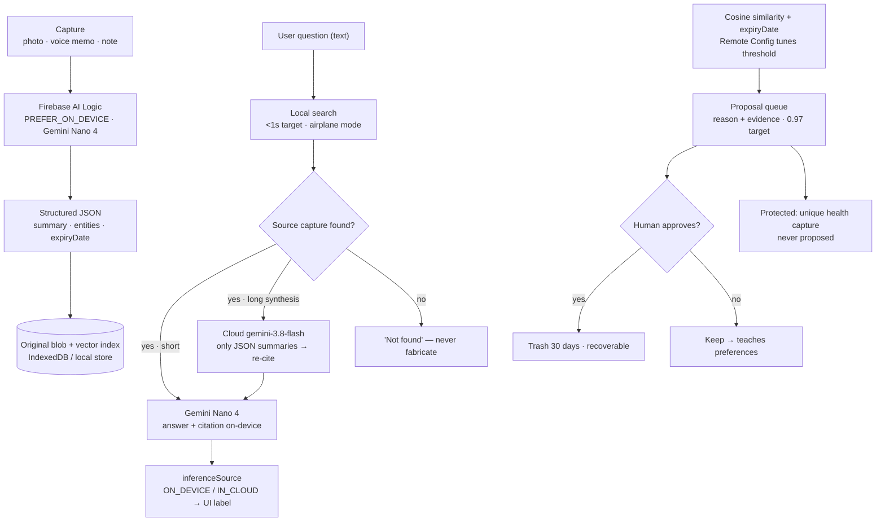
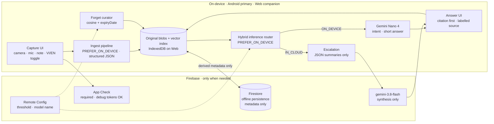

> **HISTORICAL — superseded by the extraction map below. Do not implement from this file.**
>
> Extraction map:
> - §2 value proposition → `README.md`, `docs/requirements/BRD-my-memory.md`
> - §3 solution design → `ARCHITECTURE.md`, `docs/as-built/specs/`
> - §4.2 data model → `docs/as-built/DATA.md`, `contracts/README.md`
> - §6 tool contracts → `docs/requirements/req-web-app.md`, `docs/as-built/specs/`
> - §7 risks → `docs/plan/tasks.md`
>
> Parity: partial — raw evidence, measurable requirements and executable tests are
> not extracted; remaining content stays here as history. Status checked
> 2026-11-18 against `d7aa8d2`.
>
> Amendment 2026-11-18: the former link to `../../competitions/firebase-hybrid-ai-hackathon.md`
> is broken because that file is not in this repository. It is retained only as a
> historical reference, not as an unresolved build dependency.

---
id: "AGENT-173"
name: "My Memory"
domain: "operations-services"
niche: "Personal Knowledge & On-Device Memory"
status: "concept"
competition: "#BuildHybridAI 2026"
competition_file: "competitions/firebase-hybrid-ai-hackathon.md"
track: "Android (primary) + Web/Chrome (companion)"
frameworks: ["Firebase AI Logic Hybrid Inference SDK (PREFER_ON_DEVICE)", "Gemini Nano 4 (on-device, Chrome Prompt API / Android)", "EmbeddingGemma (on-device embeddings)", "on-device ASR & OCR", "Firebase App Check", "Cloud Firestore (offline persistence)", "Firebase Remote Config", "Android (Kotlin)", "Web (Chrome) + IndexedDB", "structured JSON output"]
llms: ["Gemini Nano 4 on-device via Firebase AI Logic", "gemini-3.8-flash cloud synthesis via Firebase AI Logic (default fallback gemini-3.5-flash-lite)", "EmbeddingGemma on-device embeddings", "On-device ASR (speech-to-text)"]
tags: ["ours", "on-device-ai", "hybrid-inference", "firebase-ai-logic", "gemini-nano", "embeddinggemma", "offline-first", "privacy", "citations", "personal-knowledge", "human-in-the-loop", "structured-output", "english-first", "android", "chrome"]
created_at: "2026-11-17"
source_url: "https://muse.ai/s/my-memory-design-xoxo6xrhe0xqxoh6/5jZVMp5IlMivb8tWfmyHUuFNvBMhK_lw0Y7Z0Om1Wjs"
---

# My Memory: Conceptual Solution Design

> **One-liner:** My Memory ("Pocket Knowledge") is a second memory in your pocket: capture a photo,
> a voice memo or a note, and ask for it later in plain words — the answer comes back with the
> original capture as evidence, runs locally, and never deletes anything without your approval.

---

## 1. Challenge & Problem Statement

### 1.1 The "I've seen this before" moment

Everyone has lost a detail they had already captured: the receipt on a lunch table, the licence plate
in a parking garage, the expiry date on a medicine box. The information was photographed, recorded or
typed — it was never *found again*. The failure is not capture; it is retrieval with proof.

### 1.2 What exists, and what it misses

| Existing option | What it does well | What it misses |
| :--- | :--- | :--- |
| **Phone gallery / Files** | Keeps the original, works offline | Search by name and date only; cannot answer a question in words; no cross-modal link between a voice memo and a photo |
| **Note apps with folders** | Structured storage | Requires naming, tagging and filing at capture time — the exact moment the user has no patience for it |
| **Cloud photo search** | Finds objects and text in images | Needs a network; sends private material off the device; returns "similar images", not a verifiable answer with a cited source |
| **General chat assistants** | Fluent, long answers | Confabulate details that were never captured; a plausible wrong medicine expiry is worse than no answer |
| **"Smart cleanup" tools** | Reclaim storage | Decide what is irrelevant on the user's behalf; deleting the only blurry photo of a medicine box is an irreversible error |

The missing layer is a **memory with an evidence rule**: one local store for every capture type,
retrieval that returns the original as proof, and a forgetting policy where the machine proposes and
the human decides.

### 1.3 Why this fits #BuildHybridAI 2026

The brief asks for an app that runs prompts on-device when a local model is available and falls back
to the cloud when it is not. My Memory is designed around exactly that boundary, but with a stricter
rule than the brief requires:

- **On-device is the default**, not a fallback. Voice and daily-life habits are the most private data
  a person has; transcription, embedding and search stay on the phone.
- **Cloud is a last resort**, used only for a long Vietnamese answer that must weave together several
  captures. Even then, every factual claim must still cite an original capture.
- **The hybrid SDK is load-bearing**: `Gemini Nano 4` handles on-device intent, multimodal extraction
  and short answers; cloud inference is the explicit escalation path. This is the runtime call the
  brief requires — naming Firebase AI Logic in a README would not qualify.
- **One inference mode, two paths**: use `PREFER_ON_DEVICE` so the SDK tries the local model first and
  falls back to cloud when it is unavailable, and read `inferenceSource` (`ON_DEVICE` / `IN_CLOUD`)
  from each response so the UI can state which path produced an answer.
- **Android primary, Web/Chrome companion**: the phone owns camera, microphone and offline memory;
  the Chrome companion answers from the same design on a laptop. Two platforms is a deliberate
  multi-platform play for the Grand Prize without pretending a third platform is ready.

### 1.4 Named failure modes

1. **Fabrication** — the answer states an expiry date or amount that is not in any capture.
2. **Evidence loss** — a derived summary replaces the original, so the claim cannot be checked.
3. **Silent auto-deletion** — a cleanup routine removes the only copy of a health-related capture.
4. **Network dependence** — an offline user gets no answer, or an answer assembled elsewhere.
5. **False forgetting proposals** — a blurry but unique photo is flagged as redundant and nudged toward trash.

---

## 2. Value Proposition & Target Users

| User persona | Pain before My Memory | What changes |
| :--- | :--- | :--- |
| **Forgetful everyday user** | "Where did I see that receipt / plate / medicine box?" | Ask in words; get the original capture with a match score and date |
| **Caregiver** | Cannot recall a medicine's expiry date when shopping | "March 2027 — here is the photo you took on 12/11", with the source capture attached |
| **Commuter / driver** | Writes a licence plate down, then loses the note | Text note is searchable by content, offline, with the original retained |
| **Privacy-conscious user** | Does not want voice memos uploaded to a cloud | ASR, embedding and search run on the device; airplane mode still works |
| **Small-space dweller / frugal user** | Storage fills with duplicates and expired screenshots | Duplicate and expiry *proposals* with reasons; nothing leaves without approval |

**Why this is different:** retrieval is evidence-first (no citation, no answer) and forgetting is
governed by a hard-coded law (propose, never delete). A general assistant optimises for a fluent
answer; My Memory optimises for a *checkable* one.

**Existing strengths against the Stage Two rubric** (all four criteria are equally weighted at 25%):

| Built-in strength | Criterion it answers |
| :--- | :--- |
| Three capture types, on-device processing, offline search under 1 s — a model `PREFER_ON_DEVICE` Gemini Nano 4 demo | Technological Implementation |
| Original capture attached to every answer; "no evidence, say not found" | Technological Implementation · Potential Impact |
| Human-in-the-loop Forgetting Lab: `0.97` duplicate or expiry proposals with **zero auto-deletions before approval** | Quality of the Idea · Design |
| Coherent three-screen product (Save / Ask / Forget) with a perceivable safety boundary | Design · Potential Impact |

**What v1 does not claim:**

- It does not auto-delete anything. There is no "smart auto-clean" mode to enable.
- It does not answer without a source capture; "not found" is a valid answer.
- It does not require a network for capture, search or short answers.
- It does not give medical, legal or financial advice — it returns what the user captured.
- Numbers quoted from the concept page (`<1 s` search, `0.4 s` answer, `1.2 s` OCR + embed,
  `0.97` duplicate threshold) are **design targets**, not measured benchmarks.

---

## 3. Conceptual Solution Design & Workflow

### 3.1 Save — on-device ingestion with Gemini Nano 4

A capture is a photo, a voice memo or a typed note. No filename, folder or tag is requested. On save,
the app calls Firebase AI Logic in `PREFER_ON_DEVICE` mode with `Gemini Nano 4`: the on-device model
reads the image or transcript locally (no cost, no sensitive photo sent over the network) and returns
**schema-constrained structured JSON**:

```json
{
  "summary": "Lunch receipt — 256,000 VND",
  "entities": ["medicine name", "amount", "licence plate"],
  "expiryDate": "2027-03"
}
```

`expiryDate` feeds the forgetting rules directly; `entities` make a note searchable by content. The
same step embeds the content into one local vector space and stores the **original blob next to its
derived index entry**. The original is never replaced by the summary — that is what makes a later
answer verifiable. On Web the local model is reached through Chrome's Prompt API; on Android through
the on-device Gemini Nano runtime.

### 3.2 Ask — hybrid retrieval, cloud escalation

The user types a question. Local search runs on the IndexedDB/local vector store in `<1 s` (target)
and works with the network unplugged. `Gemini Nano 4` resolves intent and produces a short answer with
a citation to the source capture. When the question needs deep cross-capture synthesis — e.g. "sum up
all lunch expenses this month and check whether mum's current medicine interacts with the new
prescription I photographed yesterday" — the app escalates to a cloud model via Firebase AI Logic
(`gemini-3.8-flash`, with `gemini-3.5-flash-lite` as the default fallback). Only the light structured
JSON summaries travel to the cloud; the original photos stay on the device, and every claim in the
returned answer must still cite a capture. The `inferenceSource` field of the response decides the
label shown in the UI ("answered on device" vs "cloud-synthesised"). If no capture supports a claim,
the app says it could not find anything. A medicine-interaction answer is framed as *"here is what
your captures say"* — an information aid, never medical advice.

### 3.3 Forget — local rule engine + hybrid scoring

A periodic local scan combines cosine similarity over embeddings with the `expiryDate` fields Nano 4
extracted at capture time: two photos of the same receipt taken 40 seconds apart score `0.97`
similarity; an OTP screenshot has an expired date. Each candidate enters a proposal queue **with the
reason and a link to the original**. The user approves or keeps each item. Approved items move to a
30-day recoverable trash. A "keep" decision is feedback: it teaches the curator which proposals are
wrong. A protection rule overrides scoring — a unique copy containing health or safety information is
never proposed for deletion, even if it is blurry. Firebase Remote Config may tune the *scoring*
threshold (e.g. `0.95` vs `0.97`) without an app release; it can never tune the forgetting law itself.



### 3.4 The hard-coded forgetting law

The concept page calls this "the forgetting law — written in stone, not negotiable". It is the
product's boundary, not a configurable setting:

1. **Only propose, never delete.** Every removal begins with a proposal carrying evidence.
2. **Reasons must be checkable** — "duplicate 0.97", "expired 10/11", "superseded by a later capture",
   each opening the original. Vague "not relevant" is not grounds for a proposal.
3. **30-day trash, reversible.** Approval is not destruction; recovery is always available.
4. **Keeping is feedback.** Each "keep" tunes the curator to propose fewer false positives.
5. **The human decides.** No mode exists that skips this step.

> **Amendment (2026-11-18):** The governing rule for the Web companion is "the AI never deletes on
> its own", not "deletion only via proposals". Owners may manually trash individual captures (30-day
> recoverable window, undo toast) or trigger two-step permanent deletion in `DetailSheet`/`Trash`,
> and trashed items past `purgeAt` are cleaned up on app open as an explicit user-visible exception.

### 3.5 Demo flow (from the concept page)

The interactive mockup uses illustrative sample captures: a lunch receipt (256,000₫, VAT 7%), a
medicine box (expiry 03/2027, captured 12/11, match `0.93`), a café menu (chicken soup 30K, spring
rolls 60K), a `0:18` voice memo "remember to buy medicine for mum", a Wi-Fi password note, a licence
plate note, a `0:42` walking-idea voice memo, and an expired OTP screenshot. A question like "when
does mum's medicine expire?" returns "March 2027" with the 12/11 photo as evidence and reports the
answer time as `0.4 s` in airplane mode. These are mockup values, not a measured demo.

---

## 4. System & Agent Architecture

### 4.1 Components and boundary

| Component | Runs where | Responsibility |
| :--- | :--- | :--- |
| **Capture UI** | Android primary · Web companion | Photo, voice memo, note; VI/EN toggle (default EN); approval UI for proposals |
| **Ingest pipeline** | On-device | Firebase AI Logic `PREFER_ON_DEVICE` → structured JSON, OCR, ASR, embedding, original-blob storage |
| **Local memory index** | On-device | Vector index + capture metadata + retention state (IndexedDB on Web) |
| **Hybrid inference router** | On-device → cloud | `PREFER_ON_DEVICE` first; cloud only for long synthesis; reads `inferenceSource` |
| **Forget curator** | On-device | Cosine similarity + `expiryDate` scoring, protection rules, proposal queue |
| **Firebase services** | Firebase | App Check (required); Firestore offline persistence for metadata sync; Remote Config for scoring threshold and model name |

**The privacy boundary is data, not just latency:** by default, original captures never leave the
device. Cloud inference receives only the light structured JSON needed for a long synthesis and must
return claims the device can re-attach to local captures. Firestore syncs derived metadata between
phone and computer with offline persistence enabled — **never the original blobs**. No cloud capture
store exists in v1.

### 4.2 Data model

A capture record carries: `capture_id`, `type` (`photo` | `voice` | `note`), `created_at`,
`original_ref` (local blob), `derived_text` (OCR/ASR result), `structured` (`summary`, `entities`,
`expiryDate` from Nano 4), `embedding`, `source_match` (score + capture id), `inference_source`
(`ON_DEVICE` / `IN_CLOUD` of the last answer), and `retention_state` (`active` | `proposed` |
`trashed` | `protected`). Answers are not stored as new facts; they are recomputed from captures so
the evidence stays authoritative.



### 4.3 Guardrails as architecture, not prompts

- **Citation-or-refusal:** the answer path cannot emit a factual claim without a resolved
  `source_match`; absence returns "not found".
- **Original immutability:** derived text, structured JSON and embeddings are indexes; the original
  blob is read-only and never sent to Firestore or cloud inference.
- **Forgetting law:** deletion requires a recorded human decision; no background job can bypass it.
  Remote Config may change a *scoring threshold*, never this law.
- **Protection override:** `protected` captures are excluded from proposals regardless of score.
- **Escalation visibility:** `inferenceSource` from the SDK decides the UI label — on-device or
  cloud-synthesised — so a fallback can never be mistaken for a local result.
- **Advice boundary:** a medicine-interaction question returns cited capture content, not a
  recommendation; the answer says what the user captured, not what to do about it.
- **Language:** the app ships VI and EN with a corner toggle, defaulting to EN so judges can read and
  demo it without translation.

---

## 5. Technology Stack & Frameworks

| Layer | Choice | Reason |
| :--- | :--- | :--- |
| **Hybrid inference** | Firebase AI Logic Hybrid Inference SDK, `PREFER_ON_DEVICE` mode | Tries `Gemini Nano 4` locally, falls back to cloud; `inferenceSource` reports which path ran |
| **On-device model** | `Gemini Nano 4` via Chrome Prompt API (Web) / on-device runtime (Android) | The brief's mandated local model; free, private, works offline |
| **Structured extraction** | Schema-constrained JSON from the on-device model: `summary`, `entities`, `expiryDate` | Feeds retrieval and the forgetting rules with typed fields, not free text |
| **Cloud escalation** | `gemini-3.8-flash` for deep synthesis; default fallback `gemini-3.5-flash-lite` | Current stable general-use models in Firebase AI Logic; Gemini 2.5 Flash/Pro are being rerouted or retired |
| **Embeddings** | `EmbeddingGemma` on-device | Puts photos, transcribed voice and notes in one vector space, enabling text→image/voice retrieval |
| **Transcription / OCR** | On-device ASR and OCR | Keeps voice and image content on the device; the original audio stays as evidence |
| **Primary platform** | Android (Kotlin) | Camera, microphone and on-device model availability; the design's phone-first flow |
| **Companion platform** | Web (Chrome) + IndexedDB | Second-platform coverage for the Grand Prize; local index in the browser |
| **Firebase services** | App Check (required since 2026-11-02), Firestore with offline persistence, Remote Config | App Check protects the Gemini API; Firestore syncs derived metadata phone↔computer; Remote Config tunes the scoring threshold and model name |
| **Local storage** | On-device original blob store + vector index | Evidence and search stay available in airplane mode |
| **No cloud capture store** | Cloud receives only light structured JSON for long synthesis | Privacy boundary is preserved even when inference escalates |

**Open technical items (not fabricated):** (1) the concept page specifies `EmbeddingGemma` for
on-device embeddings — confirm it is reachable on both platforms; if not, keep the embedding step on
a supported local path while the *inference* call still goes through Firebase AI Logic. (2) On Web,
on-device inference uses Chrome's Prompt API; confirm image and audio inputs and Vietnamese language
support are available there (the SDK exposes `onDeviceParams.expectedInputs` languages) and review
the documented list of not-yet-supported hybrid features. (3) Model names move fast — pin a stable
model in code and keep the name overridable via Remote Config. Treat all three as build-time checks,
not established facts.

**Deliberately not in v1:** a cloud capture store, automatic deletion, multi-user sharing or family
accounts, medical/legal advice, and an iOS build. A third platform would be scope creep before the
repo, hosted URL and video exist.

---

## 6. Key Agent Capabilities & Tool Specifications

```json
[
  {
    "tool_name": "capture_ingest",
    "description": "Accept a photo, voice memo or typed note; call Firebase AI Logic in PREFER_ON_DEVICE mode with Gemini Nano 4 to return schema-constrained JSON and create a capture record with an embedding.",
    "parameters": {
      "type": "photo | voice | note",
      "original_ref": "local blob path",
      "mode": "PREFER_ON_DEVICE",
      "response_schema": { "summary": "string", "entities": "string[]", "expiryDate": "string | null" },
      "embedding_model": "EmbeddingGemma (on-device)"
    },
    "guardrail": "No naming, folder or tag is requested from the user. The original blob is stored read-only and is never replaced by the structured JSON; extraction failure keeps the original and marks the capture as unindexed rather than dropping it. A cloud fallback during extraction is labelled in the response via inferenceSource."
  },
  {
    "tool_name": "local_search",
    "description": "Search the personal capture index from a text query and return the closest captures with type, date and match score.",
    "parameters": {
      "query": "when does mum's medicine expire?",
      "scope": "local captures only",
      "latency_target": "<1 s (design target, not measured)"
    },
    "guardrail": "Runs offline; no capture leaves the device. Returns candidate captures, not answers, so a match score can never be mistaken for a verified fact. Empty results are an explicit 'no candidates' response."
  },
  {
    "tool_name": "hybrid_answer",
    "description": "Produce a short answer on-device with Gemini Nano 4, or escalate to gemini-3.8-flash via Firebase AI Logic only when a long synthesis across several captures is required.",
    "parameters": {
      "intent": "short lookup | long synthesis",
      "mode": "PREFER_ON_DEVICE",
      "local_model": "Gemini Nano 4 via Chrome Prompt API / Android on-device runtime",
      "cloud_model": "gemini-3.8-flash (default fallback gemini-3.5-flash-lite)",
      "payload_to_cloud": "light structured JSON summaries only",
      "source_label": "inferenceSource from SDK response: ON_DEVICE | IN_CLOUD"
    },
    "guardrail": "Every factual claim must carry a source capture id; otherwise the tool returns 'not found'. Escalation is explicit and the UI label comes from inferenceSource, never from a guess. The cloud receives only JSON summaries, never original blobs. A medicine-interaction answer is phrased as what the captures say, never as advice."
  },
  {
    "tool_name": "citation_verifier",
    "description": "Check each claim in a drafted answer against the referenced original capture before the answer is shown.",
    "parameters": {
      "claims": ["expiry: 03/2027"],
      "source_capture_id": "A-128",
      "on_failure": "return 'not found' for that claim"
    },
    "guardrail": "Fail closed: an unverifiable claim is suppressed rather than softened. The verifier reads only local captures and does not call the network, so it cannot be bypassed by an unavailable cloud."
  },
  {
    "tool_name": "forget_propose",
    "description": "Combine local cosine similarity over embeddings with expiryDate fields extracted by Nano 4 at capture time, and place evidence-backed proposals in a review queue.",
    "parameters": {
      "scoring": "cosine similarity over local embeddings + structured expiryDate",
      "threshold": "0.97 target, overridable via Remote Config (e.g. 0.95)",
      "evidence": "original captures + reason + score",
      "exclusions": "protected / unique health-or-safety captures"
    },
    "guardrail": "Proposals are advisory only; no deletion occurs here. Remote Config can tune the score threshold but cannot change the rule that a human must approve and that protected captures are excluded. Each proposal links to its original so the reason can be checked in one tap."
  },
  {
    "tool_name": "forget_decide",
    "description": "Record the user's approve/keep decision and move approved captures into the recoverable trash.",
    "parameters": {
      "decision": "approve | keep | restore",
      "proposal_id": "p-042",
      "trash_retention_days": 30
    },
    "guardrail": "A recorded human decision is mandatory; there is no auto-approve path. Approved items are recoverable for 30 days. 'Keep' updates curator preferences and is logged as feedback, never as permission to delete later."
  }
]
```

---

## 7. Production Considerations, Risks & Mitigations

- **Hallucinated details.** A wrong medicine expiry is a safety problem, not a UX nuisance. The
  citation-or-refusal rule is enforced in `citation_verifier` before display; "not found" is the
  expected failure output. The product cannot be tricked into filling gaps because no path exists
  that emits an uncited claim.
- **Evidence loss.** Summaries are indexes, not replacements. The original blob is read-only, and
  every answer can be traced to a capture id, type, date and match score.
- **Vietnamese ASR and OCR errors.** Transcripts may misread handwriting or accented speech. Keep the
  original audio/photo for inspection, show the derived text as derived, and let the user correct the
  transcript without mutating the original.
- **False forgetting proposals.** The `0.97` similarity value is a starting target, not a validated
  threshold. Mitigations: evidence-linked reasons, protected capture classes, explicit human
  approval, a 30-day recoverable trash, and "keep" as negative feedback. A blurry unique medicine
  photo is deliberately shown as *protected* in the concept page to make this rule visible.
- **On-device model availability.** A device without Gemini Nano 4 — or the Web companion in a
  browser lacking it — must degrade gracefully. Escalate to cloud for the query, label the answer as
  cloud-synthesised, and keep capture/search local. Availability is checked, never assumed.
- **Embedding model support.** `EmbeddingGemma` availability through Firebase AI Logic's hybrid API
  is unverified. Confirm during implementation; keep the embedding step replaceable and keep the
  hybrid inference call real regardless of which on-device embedder is used.
- **On-device input modalities on Web.** Chrome's Prompt API is the Web path for Gemini Nano 4;
  image/audio input and Vietnamese language support must be confirmed against the current hybrid
  "features not yet supported" list. If an input type is not available locally, fall back to cloud
  for that extraction and label it via `inferenceSource` — never silently pretend it ran locally.
- **Model churn.** Firebase AI Logic is retiring Gemini 2.5 Flash/Pro; `gemini-3.8-flash` and
  `gemini-3.5-flash-lite` are the current stable choices. Pin the name in code and keep it
  overridable through Remote Config so a submission does not break on a model change.
- **Remote Config vs the forgetting law.** A tunable `0.95` / `0.97` threshold is a scoring knob,
  not permission to auto-delete. Keep the law in code: propose, human approves, 30-day trash,
  protected captures excluded. A config value must never bypass a human decision.
- **Metadata sync is not a privacy loophole.** Firestore with offline persistence carries only
  derived metadata between phone and computer. It must never receive original blobs, transcripts or
  embeddings that could reconstruct a capture.
- **Language compliance.** The brief requires English materials and an English demo. The UI needs a
  VI/EN toggle in the corner, default EN for judges; the demo video, repo README and submission text
  stay in English, with Vietnamese as an optional toggle rather than the default.
- **Latency claims are targets.** `<1 s` search, `0.4 s` answer and `1.2 s` OCR+embed come from the
  concept page's mockup. Measure on a real device before repeating them in a submission; label them
  as targets until then.
- **Privacy boundary under cloud escalation.** Originals never go to the cloud. Only light structured
  JSON for a long synthesis is sent, with App Check enabled (required since 2026-11-02) and debug
  tokens used only for judging. No production keys, PII or real captures in the repository or
  submission materials.
- **Scope pressure.** Two platforms plus a curator plus a citation verifier is already full. The hard
  cap is: capture, local search, hybrid answer, forget queue, approval UI, Web companion, Firestore
  metadata sync. No iOS, no sharing, no cloud capture store before the repository, hosted URL and
  <3-minute video exist.
- **Submission compliance, checked 2026-11-17:** public GitHub/GitLab repo with an open-source
  license and Firebase AI Logic called at runtime (`PREFER_ON_DEVICE` with Gemini Nano 4 plus a real
  cloud escalation) — **not started**. Hosted URL — **not deployed**. <3-minute public YouTube demo
  in English — **not recorded**. App Check enabled with debug tokens, Firestore offline persistence
  and Remote Config threshold wired — **planned**.

---

## 8. Source & Git Repository Insights

- **Status:** concept. The source is an interactive design concept page with illustrative sample data,
  explicitly labelled as a mockup; there is no repository, hosted build or real capture data yet.
  Design source: [My Memory · Pocket Knowledge](https://muse.ai/s/my-memory-design-xoxo6xrhe0xqxoh6/5jZVMp5IlMivb8tWfmyHUuFNvBMhK_lw0Y7Z0Om1Wjs).
- **Competition:** #BuildHybridAI 2026 —
  target **Android primary + Web/Chrome companion**. Submission closes **2026-11-30, 2:00 PM PT**;
  finals ~2026-12-21.
- **Demo beat (under 3 minutes, English UI and voiceover):** type "when does mum's medicine expire?"
  on a phone in airplane mode → `03/2027` with the 12/11 photo, match `0.93`, and a `0.4 s` target
  label; show the `ON_DEVICE` badge. Then ask a cross-month question that triggers cloud escalation
  and show the `IN_CLOUD` badge while the original photo stays local. Open the forget queue, show a
  `0.97` duplicated receipt and an expired OTP, protect the blurry unique medicine photo, approve one
  item, restore it from the 30-day trash. Close on: *capture anything, remember it, ask anything, get
  it back — and nothing is deleted without you.*
- **Design lines worth keeping in the submission:** "no citation, no answer"; "AI proposes, the
  human decides"; "offline is not a degraded mode — it is the default". The differentiator for a
  judge is the evidence rule, not the chat interface. These map directly to **Quality of the Idea**
  and **Design** (25% each of the Stage Two score).
- **Submission checklist additions:** VI/EN toggle present and defaulting to EN; App Check enforced
  (debug tokens registered for judges); Firestore offline persistence enabled for metadata only;
  Remote Config threshold wired with the forgetting law still hard-coded; repo README and video in
  English.
- **Open questions:** Is `EmbeddingGemma` reachable through Firebase AI Logic hybrid inference on
  both selected platforms? Does Chrome's Prompt API accept image/audio input and Vietnamese on the
  Web path? How accurate is on-device Vietnamese ASR for the voice-memo flow? Does Firestore metadata
  sync give the Web companion a usable view without copying captures? What cloud synthesis latency
  is acceptable before the answer should be refused? Can the Web companion satisfy the "actually
  called at runtime" check with the same code path as Android?
