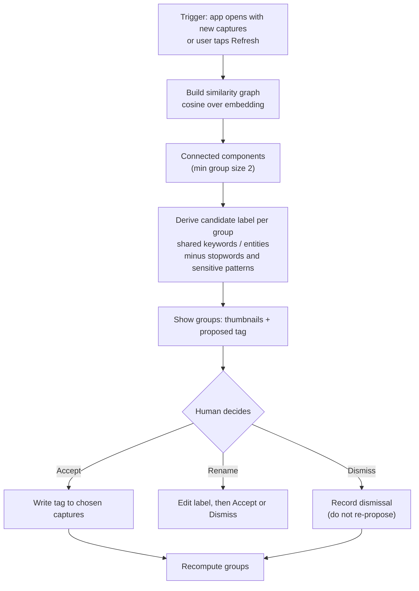

# Auto tagging flow (design spec)

Status: **AGREED 2026-11-18 — all open questions closed. Not implemented.**
Everything below is `Claimed` design intent. Implementation truth will live in
`docs/as-built/specs/` after build.

> **RFC 003 — agreed design, frozen at agreement (2026-11-18).** Unlike RFCs
> 000–002 (historical, superseded), this file is the current design for work
> tracked in `docs/plan/tasks.md` § Tags & suggested groups. It is still not a
> build source: implementation proceeds from the plan and code. Changes are
> dated amendments; after implementation, as-built truth lives in
> `docs/as-built/specs/` and supersedes this file.

> **Dated amendment — 2026-11-19:** the "Groups" section is now implemented as
> *editable embedding groups* in `Memories` (`ENT-005`, IndexedDB v2). Date
> buckets (Today/Yesterday/Older) became filter chips, not group keys. Groups
> are local-only, never synced, and user-editable (rename / split / move /
> delete-group-keeps-captures); manual overrides survive auto re-clustering.
> This is an extension of the agreed design, not a silent body edit.

- Owner: Duy
- Created: 2026-11-18
- Task group: `docs/plan/tasks.md` § Tags & suggested groups
- Data model: `docs/DATA.md` §2.1 (`tags`, `suggestedTags`), §9.1 (layers)
- Governing rules: `F5` / `ADR-005` (model proposes, human disposes),
  `ADR-007` (cross-language), `INV-002` (trashed excluded), `INV-003`
  (protected never proposed)
- Supersedes: nothing. On implementation, as-built truth → `docs/as-built/specs/`.

## 1. Problem

Today `entities` (model-extracted at capture time) double as tags: they are
rendered as chips in `DetailSheet` and mixed into the search index
(`src/lib/search.ts`). They fail as tags because they are **derived**:

- the user cannot add or remove them;
- re-extraction rewrites them, silently discarding user intent;
- extraction quality is uneven, so wrong labels stick ("auto tagging đang sai").

Fix: give the user a real tag layer, and demote `entities` to what they are —
an automatic index. Automatic tag *suggestions* may then come from the local
corpus, but only as proposals.

## 2. Goal and non-goals

| Goal | Non-goal |
|---|---|
| User-authored `tags` that survive re-extraction | Editing `entities` in place |
| Automatic grouping of similar captures (local embeddings) | Cloud clustering or any upload of embeddings |
| A suggested label per group, proposed to the user | Applying a tag without an explicit Accept |
| Suggestions improve recall in search after acceptance | A tag taxonomy, hierarchy, or shared/ public tags |
| Works offline, in EN and VI (`ADR-007`) | Auto-merging or renaming the user's existing tags |

## 3. Tag layers

| Layer | Field | Owner | Written when | Re-extraction |
|---|---|---|---|---|
| Auto entities | `entities` | model | extraction | may rewrite |
| User tags | `tags` | user | explicit add / remove | never touched |
| Suggestions | `suggestedTags` | grouping | proposal only | recomputed as groups change |

Only `tags` are product truth: they join the search index, drive filtering and
timeline grouping. `entities` remain a search aid. `suggestedTags` influence
nothing until accepted (`docs/DATA.md` §9.1).

## 4. Trust boundary

The model proposes, the human disposes — the same rule as Forget (`F5`):

- No code path writes `tags` from a suggestion without a recorded Accept.
- Dismissing a suggestion is as valid as accepting one; both are recorded.
- A suggestion never changes `retentionState`, never unlocks a protection, and
  never reaches Firestore (class C2/C8 never sync).
- Labels derive from private capture content, so suggestion generation is
  **local only** — no cloud model call in this flow (stricter than short-answer
  inference, because a label is an unattended summary of private content).

## 5. Flow

### Steps

1. **Trigger.** *(Decided 2026-11-18, Q5)* Suggestions are generated
   automatically when the app opens and new captures exist, with a manual
   refresh in the Groups section. This stays safe by construction: generation
   writes `suggestedTags` **proposals only** and never `tags` — the same split
   as Forget's `scanForProposals`, where producing a proposal is code's job and
   deciding is the human's. No Accept/Rename/Dismiss decision is ever
   automatic.
2. **Build graph.** Pairwise cosine similarity over `embedding` for all
   non-trashed captures (`INV-002`). Edge when similarity ≥ the applicable
   threshold — per capture type, and the higher of the two for a cross-type
   pair (§6).
3. **Components.** Connected components, minimum size 2. A capture may belong
   to one group only; if components overlap through weak edges, keep the
   highest-mean-similarity assignment.
4. **Label.** Candidate tag from tokens shared across group members:
   `entities` ∩ frequent content words of `summary`/`derivedText`, stopwords
   removed (EN + VI), sensitive patterns removed (see §8). Optional upgrade:
   on-device Nano generates a short label from group summaries with
   `ONLY_ON_DEVICE`; keywords remain the fallback when Nano is unavailable.
   *(Open questions Q1, Q2.)*
5. **Present.** Each group shows its captures (thumbnails), the proposed tag,
   and Accept / Rename / Dismiss. Accept can target all members or a selected
   subset. *(Open question Q3.)*
6. **Decide.**
   - **Accept** → write `tags` (append, de-duplicated) to the chosen captures.
   - **Rename** → free-text edit, then treat as Accept or Dismiss.
   - **Dismiss** → record the dismissal so the same suggestion is not offered
     again for the same group membership. *(Open question Q4.)*
7. **Recompute.** Groups and suggestions refresh on the next trigger — after
   capture create/delete, tag edit, threshold change (Remote Config), or the
   explicit generate action. A dismissed suggestion is not regenerated; an
   accepted tag makes its group members no longer suggest that label.

## 6. Algorithm details

| Parameter | Decision | Notes |
|---|---|---|
| Similarity | cosine over `embedding` | local lexical fallback at HEAD (`ADR-009`); grouping quality tracks embedder quality |
| Threshold | **per capture type** (`photo`, `voice`, `note`), each Remote Config tunable (decided 2026-11-18, Q2) | all three start at 0.85 pending measurement; for a cross-type pair the higher (more conservative) of the two thresholds applies |
| Min group size | 2 | singletons get no suggestion |
| Complexity | O(n²) pairwise | fine for a personal corpus (thousands); run on demand |
| Language | one space for EN/VI (`ADR-007`) | mixed-language groups are valid; label language follows the majority token language (decided Q6) |

Determinism: same corpus + same threshold ⇒ same groups and labels, so a
dismissal can be matched reliably.

## 7. Proposal lifecycle

| State | Where | Transition |
|---|---|---|
| none → suggested | `suggestedTags` + group snapshot | generate (auto on app open with new captures, or manual refresh) |
| suggested → accepted | `tags` on captures | Accept (human) |
| suggested → renamed → accepted | `tags` | Rename then Accept (human) |
| suggested → dismissed | dismissal record in `meta` | Dismiss (human) |
| suggested → none | `suggestedTags` | recompute removes stale suggestions |

Dismissals are stored in the `meta` store keyed by a stable fingerprint (sorted
capture ids + label), so recompute cannot nag the user. Accepted tags are never
regenerated as suggestions.

## 8. Privacy and safety bounds

- **Local only.** Grouping and label derivation use on-device data and models.
  No embedding, summary or label is sent to the cloud by this flow.
- **Never synced.** `tags` and `suggestedTags` are outside the Firestore
  allowlist (`docs/DATA.md` §4.2).
- **Sensitive label filter.** Candidate labels must not contain OTP-like digit
  runs, password-like tokens, or values flagged as sensitive from `entities`
  (see plan § P1 "consent before sending sensitive entities"); such tokens are
  dropped before a label is proposed. A user may still type anything into their
  own `tags`.
- **Protected captures** (`F4`) can be grouped and tagged by their owner;
  grouping never changes protection and never proposes forgetting.

## 9. Interaction with other flows

| Flow | Interaction |
|---|---|
| Search / Ask | accepted `tags` join the index and boost matches; `suggestedTags` do not |
| Forget (`F1`/`F2`) | tagging never touches `retentionState`; a tag is not forget evidence |
| Import (batch) | imported captures join grouping like any capture; EXIF date affects timeline only |
| Manual delete | trashed captures leave groups (`INV-002`); their tags travel with the record to trash/purge |
| Demo mode | `demo: true` captures group and suggest normally inside the demo namespace |

## 10. Edge cases

- **Mixed-language group** — label in the majority language; tags themselves
  are language-agnostic strings.
- **No shared keyword** — propose nothing rather than a vague label ("stuff").
- **Sensitive content in group** — filter tokens (§8); if the label becomes
  empty, propose nothing.
- **Overlapping similarity** — one group per capture (§5 step 3); deterministic
  tie-break by mean similarity then by earliest `capturedAt`.
- **Re-extraction changes `entities`** — suggestions may change on recompute;
  accepted `tags` are untouched.
- **Group dissolves after deletion** — its unaccepted suggestions are dropped;
  its dismissal records persist (harmless, id-keyed).

## 11. Verification plan

| # | Check | Expected |
|---|---|---|
| V1 | Two near-identical captures | one group, one suggested label |
| V2 | Accept | `tags` written only after Accept; survives re-extraction |
| V3 | Dismiss | same suggestion not re-offered after recompute |
| V4 | Rename then Accept | renamed label stored, not the original |
| V5 | Trashed capture | never in a group (`INV-002`) |
| V6 | Protected capture | groupable, protection unchanged (`INV-003`) |
| V7 | Sensitive token in candidate label | token dropped or no label proposed |
| V8 | EN + VI captures of the same subject | one group, sensible label (`ADR-007`) |
| V9 | Firestore sync enabled | no `tags`/`suggestedTags` in any write |
| V10 | Nano unavailable | keyword fallback still proposes; nothing labelled `SIMULATED` |
| V11 | Same similarity score on a photo pair and a voice pair | thresholds apply per type; a cross-type pair uses the higher threshold |

All `UNVERIFIED` until a run is recorded in `docs/as-built/VERIFICATION.md`.

## 12. Decisions (all closed 2026-11-18)

- **Q1 — Label source: keyword-first, Nano when available.** Shared keywords
  are the baseline; when Nano is available it may generate a nicer label
  (`ONLY_ON_DEVICE`); keywords remain the fallback. Nothing in this flow calls
  the cloud.
- **Q2 — Thresholds: per capture type.** Separate similarity thresholds for
  `photo` / `voice` / `note`, each Remote Config tunable (default 0.85 for all
  until measured). A cross-type pair uses the higher, more conservative of the
  two thresholds.
- **Q3 — Accept granularity: whole group + deselect.** Accept tags every
  member by default; the user unticks individual captures before confirming.
- **Q4 — Dismissal memory: permanent per group-fingerprint.** Stored in `meta`;
  the same group + label is never re-proposed, and recompute respects it.
- **Q5 — Trigger: auto-generate on app open when new captures exist** (plus a
  manual refresh). Generation writes proposals only (see §5 step 1); the
  human-decision rule governs writing `tags`, not producing suggestions.
- **Q6 — Label language: majority token language** of the group. No config; a
  bilingual label is not produced by default.
- **Q7 — UI location: a "Groups" section inside `Memories`** (thumbnails,
  proposed tags, Accept/Rename/Dismiss). Manual tagging stays in `DetailSheet`.
